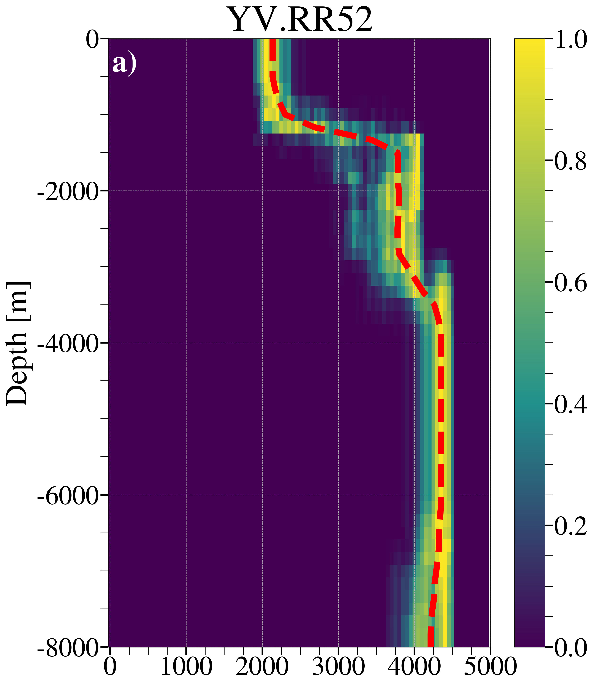
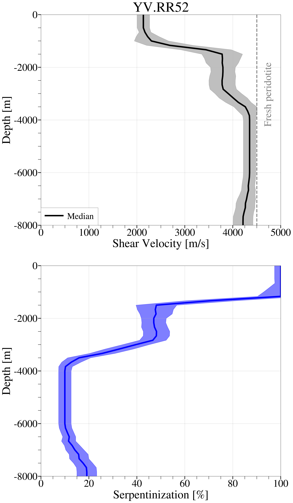
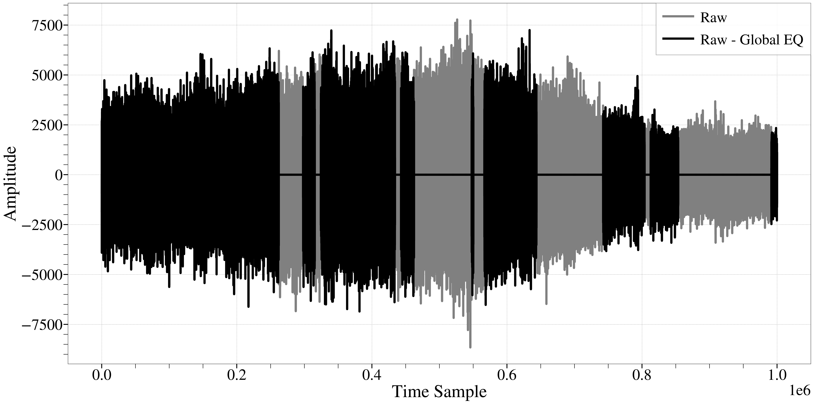
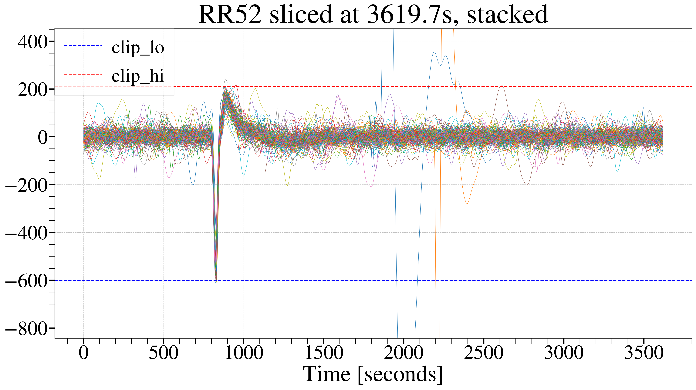
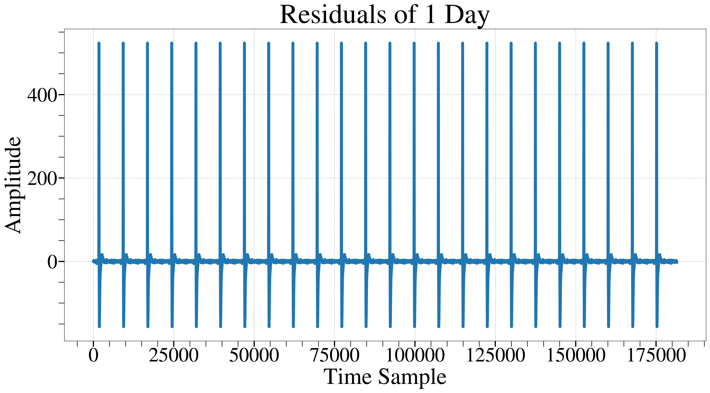
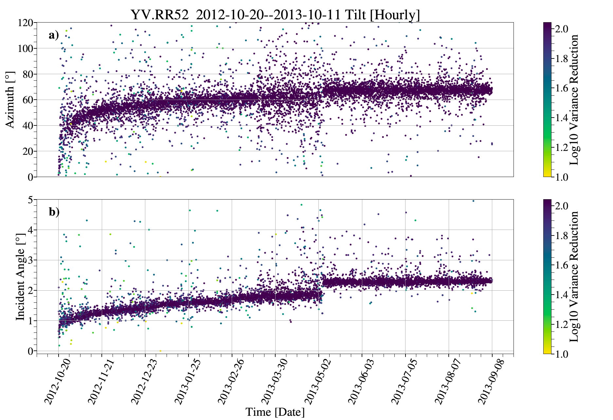
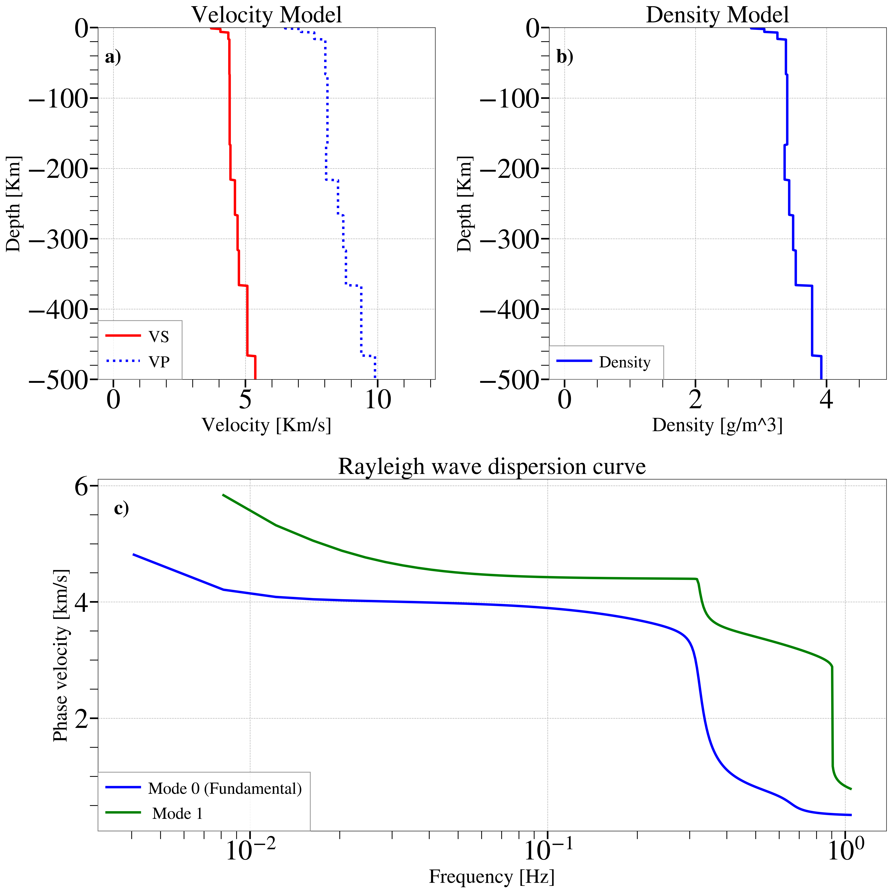
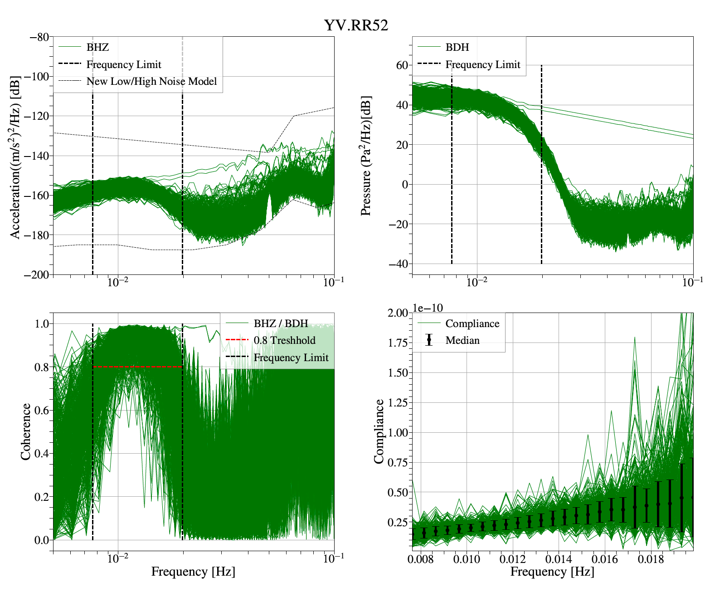
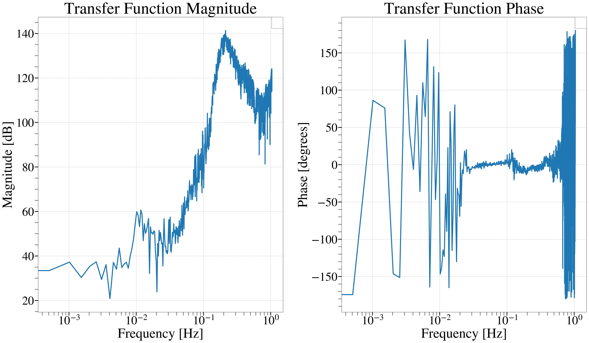
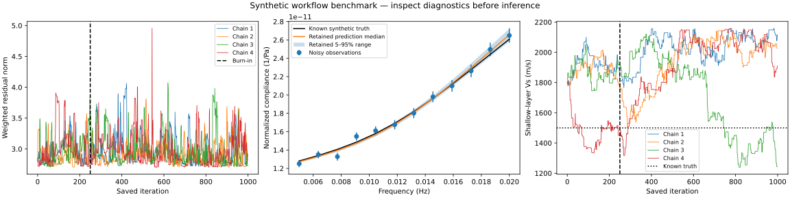

# ComPy 2.4

**Seafloor compliance processing, pressure-gauge calibration and layered elastic inversion.**

<p align="center"></p>

[](https://github.com/MohammadAmin-Aminian/ComPy/actions/workflows/tests.yml)
[](https://zenodo.org/doi/10.5281/zenodo.13380107)
[](https://orcid.org/0009-0001-9192-2734)
[](https://doi.org/10.1093/gji/ggaf253)
[](https://fr.linkedin.com/in/mohammad-amin-aminian-061b86298)

**Author:** [Mohammad-Amin Aminian](https://orcid.org/0009-0001-9192-2734) — geophysicist and scientific-software developer working across ocean-bottom seismology, seismic signal processing, seafloor compliance and inversion. See the [research software portfolio](PORTFOLIO.md).

ComPy was developed for broadband ocean-bottom stations in the RHUM-RUM
experiment. It supports earthquake/transient preprocessing through TiSKitPy,
tilt correction, teleseismic differential pressure gauge (DPG) calibration,
compliance estimation and Metropolis sampling of layered shear-velocity models.

The scientific study is [Aminian et al. (2025), Geophysical Journal
International](https://doi.org/10.1093/gji/ggaf253). Version 2 is a software
revision of the research code, **not a claim that the published results have
been reproduced with the revised implementation**. Changes that affect
numerical results are described in [CHANGELOG.md](CHANGELOG.md).

## Research results

The figures below present the RHUM-RUM research workflow and its station results.
They are the existing research figures supplied with this repository. Their
provenance is the original workflow; they have not been regenerated with v2.
The [study](https://doi.org/10.1093/gji/ggaf253) provides the scientific context.

> **Corrections (2.4).** These historical figures come from the legacy figure
> code. Its heat-map depth ticks assume 167-m rows where the rows are 100 m,
> so depths are labelled 5/3 too deep (F1). Its serpentinization uses
> (9000 − 2 Vs)/30 instead of the 4.2/2.2 km/s relation in the paper's
> caption (F2). The re-processed and re-inverted YV models, with true depths and
> the corrected serpentinization, are in
> [docs/yv_inversion_2026-10-29](docs/yv_inversion_2026-10-29/README.md).
> The audit is in [docs/INVERSION.md](docs/INVERSION.md).

### Shear-velocity structure beneath RR52

<p align="center"><a href="_Images/Inversion.png"></a></p>

**Inversion result.** The RR52 figure shows the distribution of sampled
shear-velocity models with depth. The shallow low-velocity structure and the
increase in velocity below it are visible in the model-density image. Colours
show normalized density; the overlaid profiles allow comparison with the sampled
models. Density in this historical figure should not be taken as a convergence
diagnostic for a new chain. The measured compliance example is shown in the
[compliance workflow](#compliance).

### Velocity-based serpentinization interpretation

<p align="center"><a href="_Images/Serpentinization.png"></a></p>

**Interpretation.** The upper panel presents the RR52 shear-velocity profile;
the lower panel translates velocity into an inferred serpentinization percentage.
This conversion assumes that the velocity anomaly is caused by serpentinization.
The percentage depends on that assumption and the adopted velocity relationship;
the compliance inversion alone does not distinguish serpentinization from other
causes of reduced velocity.

Click any research figure to inspect its full-resolution image. Processing,
calibration and quality-selection figures are included beside their workflow
steps below.

## Installation

Python 3.10 or later is required. A virtual environment is recommended.

```bash
git clone https://github.com/MohammadAmin-Aminian/ComPy.git
cd ComPy
python -m venv .venv
source .venv/bin/activate
python -m pip install -e '.[dev]'
python -m pytest -q
```

On Windows, activate with `.venv\Scripts\activate`.
The distribution is named `seafloor-compy`; the existing module imports remain
`compy`, `inv_compy`, `Pressure_calibration` and `ffplot`. This repository is
installed from source; the installation command does not assume a PyPI release.

Runtime dependencies are NumPy, SciPy, Matplotlib, ObsPy, TiSKitPy 2.3 and disba.
The pressure calibration needs the `disba` Rayleigh-wave mode calculator, which
uses Numba; install Numba with conda rather than pip (`conda install numba`,
then `pip install disba`). Numba also speeds up the 2.3 inversion forward model.
No external CPS executable is required by the built-in compliance propagator.
Imports do not contact station services. Data download, automatic earthquake
catalog retrieval and station-depth lookup require network access.

## Input conventions

| Operation | Vertical channel | Pressure channel | Other inputs |
|---|---|---|---|
| `Calculate_Compliance*` | response-corrected **displacement, m** | nominal response-corrected pressure, **Pa** | positive water depth, m; multiplicative pressure gain |
| `calculate_spectral_ratio` | raw counts; response removed internally to acceleration | raw counts; response removed internally to pressure | response inventory, earthquake windows |
| `Rotate` | physically consistent seismic channels | passed through cleaning workflow | `*1`, `*2`, `*Z` seismic channels |
| `calc_norm_compliance` / inversion | measured normalized compliance, **1/Pa** | not used directly | Hz, m; model columns below |
| `phase_dispersion` | not used | not used | disba model in **km, km/s, km/s, g/cm³** |

`*Z` denotes the vertical component and `*H` the pressure channel (normally
`BDH`), not a horizontal seismometer. ComPy expects exactly one of each for
spectral processing. Use one station and one response epoch at a time. Merge
trace fragments and resolve gaps explicitly before analysis. Masked samples,
nonfinite data, duplicate trace IDs, unequal sample rates and off-grid start
times are rejected by the core processing helpers.

For inversion and the elastic forward calculation the model columns are:

```text
[finite-layer thickness (m), density (kg/m³), Vp (m/s), Vs (m/s)]
```

The last row is an elastic half-space; its thickness does not enter the
propagator. Use zero there in custom models. The preserved station templates
retain their historical last-row thickness, which is also ignored physically.
Do not pass a disba model directly to the elastic compliance solver.

Pressure gain is defined as `calibrated_pressure = gain_factor * nominal_pressure`.
Consequently pressure PSD is multiplied by `gain_factor**2`. Apply the gain
once. Instrument-response removal is separate from pressure calibration.

## Processing workflow

1. Download/read seismic and pressure data together with their StationXML
   response inventory; check response epochs, units, timing and gaps.
2. Decimate with an anti-alias filter and remove the appropriate instrument
   responses. Use displacement for compliance and acceleration for calibration.
3. Identify earthquake intervals and periodic transients using TiSKitPy.
4. Correct seismic tilt and horizontal coherent noise.
5. Estimate the pressure gain from suitable teleseismic Rayleigh windows.
6. Estimate compliance in complete windows and inspect the quality selection.
7. Supply defensible observation uncertainties and a starting model to inversion.
8. Inspect multiple chains, burn-in, mixing and model sensitivity before
   reporting a scientific result.

### Compliance with the 2.2 tools

Version 2.2 adds an unattended chain that follows Aminian et al. (2025, §4).
The audit behind it is in [docs/AUDIT_2026-10.md](docs/AUDIT_2026-10.md).

```python
import compy, compy_cleaning as cleaning
from compy_processing import GJI2025, coherent_band, stacked_compliance

rotated = cleaning.rotate_smoothly(
    st, hour_centres, angles, azimuths
)  # hourly CleanRotator angles
spans = cleaning.sta_lta_spans(
    rotated.select(component="Z")[0]
)  # plus TimeSpans.from_eqs
cleaned = compy.remove_coherent_noise(rotated, 24, avoid_spans=..., cover_all=True)
pair = cleaned.select(channel="BHZ") + cleaned.select(channel="BDH")
windows = compy.split_stream(pair, 2100)  # 35-min, non-overlapping
result = stacked_compliance(
    windows, depth, gain, band=(0.007, 0.019), criteria=GJI2025, nseg=1024
)
result.compliance, result.uncertainty, result.phase_deg, result.n_windows
```

`stacked_compliance` returns k·|S_pz|/S_pp from cross-spectra stacked over
the windows, with the gravity correction applied, together with the Bendat &
Piersol error. The legacy `Calculate_Compliance*` functions keep their
historical gates.

The files in [`_Example/`](./_Example/) show command-line workflows and a runnable
offline synthetic example. Paths and network/station selection must match your
own data; no station-specific gain should be transferred to another sensor.

### Earthquakes and periodic transients

TiSKitPy 2.3 accepts the time bounds as a tuple:

```python
import tiskitpy

spans = tiskitpy.TimeSpans.from_eqs(
    (zdata.stats.starttime, zdata.stats.endtime),
    minmag=5.5,
    days_per_magnitude=0.5,
    save_eq_file=False,
)
```

Periodic transients require a configured **instance**, including transient
period, timing and clipping parameters; they are not class-level operations.
Use the deployment-specific example and the
[TiSKitPy documentation](https://tiskitpy.readthedocs.io/latest/) to configure it.

<p align="center"><a href="_Images/EQ_Removal.png"></a></p>

**Earthquake exclusion.** The waveform comparison illustrates the intervals
identified for exclusion before estimating the repeating instrumental transient.

<p align="center"><a href="_Images/Glitch_Stack.png"></a></p>

**Transient stack.** Aligned RR52 waveform slices expose the repeating pulse;
the clipping bounds define the samples used to estimate its representative shape.

<p align="center"><a href="_Images/Residuals.png"></a></p>

**Residual diagnostic.** The one-day residual plot makes the repeating pulse
structure visible. Inspect residuals after cleaning to check whether transient
energy remains and whether useful seismic signals were preserved.

### Tilt correction

```python
import compy

rotated, azimuth, angle, variance_ratio = compy.Rotate(
    displacement_stream, time_window=1, plot=False
)
```

`time_window` is in hours. The function processes complete, non-overlapping
windows and returns a merged ObsPy Stream. The final incomplete window is
omitted. `variance_ratio` means **after / before**, so values below one mean
reduced vertical variance. A failure identifies the affected window and raises
an exception; failed windows are not silently returned as cleaned data. The
input stream is copied. TiSKitPy supports additional orientation conventions;
this wrapper uses numbered horizontal components (`*1`, `*2`).

<p align="center"><a href="_Images/RR52_Tilt.png"></a></p>

**Tilt estimates.** The RR52 example tracks the estimated tilt azimuth and
inclination through time, coloured by logarithmic variance reduction. It shows
how the inferred orientation and effectiveness vary between processing windows.

### Pressure calibration

```python
import Pressure_calibration as dpg

gain = dpg.calculate_spectral_ratio(
    raw_stream,  # raw counts, vertical and pressure
    mag=7,
    f_min=0.03,
    f_max=0.07,
    inventory=inventory,  # StationXML with both responses
    event_spans=spans,
    zchan="BHZ",  # explicit channel codes (optional)
    pchan="BDH",
    filt_freq1=0.005,  # band-pass pre-filter, below f_min ...
    filt_freq2=0.1,  # ... and above f_max
    plot_condition=True,
)
```

`return_details=True` returns a dict with the per-event gains and their
standard deviation (the ±5 % of Aminian et al. 2025, Table 1).

Omitting `inventory` downloads response metadata; omitting `event_spans`
retrieves earthquake windows using TiSKitPy. Supply both for offline processing.
Each event is processed independently, including a single-event dataset.
Calibration compares measured P/a divided by `rho * water_depth` with the
water-column theoretical ratio. The positive least-squares gain is fitted
analytically rather than searched in increments of 0.01. The strongest vertical
amplitude is used as a window-selection heuristic; this is not a seismic travel
time calculation. Visually check that the selected energy is Rayleigh-wave
energy. A calibration band crossing an invalid theoretical response is rejected.

Calibration coherence thresholds use **magnitude-squared coherence**. Compliance
outputs use **amplitude coherence**, its square root. These thresholds are not
interchangeable.

<p align="center"><a href="_Images/DPGCalibration_Signal.png"></a></p>

**Calibration event.** Waveform and spectral panels document the selected
Rayleigh-wave interval and the pressure–acceleration comparison used for calibration.

<p align="center"><a href="_Images/DPGCalibration.png"></a></p>

**Pressure-gauge calibration.** Coherence identifies useful frequency intervals;
the spectral-ratio comparison shows how the gain correction aligns the measured
ratio with the theoretical response in the calibration band.

<details>
<summary>Reference model and Rayleigh-wave dispersion</summary>

<p align="center"><a href="_Images/DPG_Dispersion.png"></a></p>

**Dispersion diagnostic.** The reference velocity and density profiles are shown
with Rayleigh-wave phase-velocity curves. This is model context for the calibration
workflow, rather than an additional compliance-inversion result.

</details>

### Compliance

```python
curves, coherence, windows, frequency, full_frequency, scatter = (
    compy.Calculate_Compliance_beta(
        displacement_pressure_stream,
        depth=4000,
        gain_factor=gain,
        time_window=2,
        f_min_com=0.007,
        f_max_com=0.02,
        nseg=4096,
        plot=False,
    )
)
```

Providing `depth` avoids station-service calls. If omitted, depth is determined
from the vertical channel's elevation at the record start time.

| Function | Return tuple | Processing-window step |
|---|---|---|
| `Calculate_Compliance_beta` | curves, amplitude coherence, selected streams, selected frequencies, full frequencies, standard deviation across curves | 5 minutes |
| `Calculate_Compliance` | same first five items, peak-to-peak scatter, first-window theoretical uncertainty estimate | 1 minute |

`curves` has shape `(accepted_windows, frequency_bins)`. `coherence` contains
full-frequency arrays matching the selected windows. Beta returns frequencies
from 0.001–0.1 Hz; the older estimator returns 0.005–0.025 Hz. The requested
compliance band controls selection. Restrict results to the physically useful
band before inversion; returning a bin does not establish that it is reliable.

The default spectral segment length is 4096 samples, with 50% segment overlap
and a Hann window. All auto- and cross-spectra use the same mean-Welch estimator.
Frequency spacing is `sampling_rate / nseg`; `nseg` must fit inside each complete
processing window. Quality selection retains the historical station-oriented
coherence and pressure/vertical PSD gates; these are empirical gates, not
universal thresholds for every deployment. No accepted windows produces a clear
`ValueError`.

Gravity-wave wavenumber solves `omega² = g*k*tanh(k*H)` with a bounded root
solver. The gravity correction converts wave-attraction acceleration to
compatible displacement units before combining it with Z/P. The acceleration
correction constant is `3.07e-6 s⁻²`.

**Scatter is not standard error.** Theoretical uncertainty uses amplitude
coherence, `abs(eta)*sqrt(1-gamma²)/(gamma*sqrt(2*n))`. Zero coherence yields
infinite uncertainty. Overlapping spectral segments and processing windows
are correlated; the nominal average count does not by itself supply an
independent effective sample count. Include calibration uncertainty separately.

<p align="center"><a href="_Images/RR52_window_selection.png"></a></p>

**Window selection.** Pressure and vertical spectra are compared with their
coherence through time. Frequency limits and highlighted windows show how the
research workflow selected observations for compliance estimation. Read thresholds
from this historical figure in its original context; current gates are documented
above.

<p align="center"><a href="_Images/Compliance.png"></a></p>

**Measured compliance.** The RR52 panels show vertical and pressure power spectra,
pressure–vertical coherence, and the ensemble of selected compliance curves with
a median summary. The dispersion between curves is a useful quality diagnostic;
it is not automatically the uncertainty of the median or an independent sample count.

### Bayesian Vs inversion (2.3, `compy_inversion`)

The recommended path from a compliance estimate to a shear-velocity model.
It follows Zha & Webb (2016) for the parameterization and the sampler, and
Aminian et al. (2025) for the CRUST1.0 Moho and the 5 % gain uncertainty.
The method, the audit of the earlier inversion code and the validation are in
[docs/INVERSION.md](docs/INVERSION.md).

```python
import compy_inversion as ci

column = ci.crust1_column(-20.4723, 68.1094, "crust1.0/")  # CRUST1.0 files
data = ci.ComplianceData.from_npz(
    "RR52_compliance_compy.npz",  # stacked_compliance output (2.2)
    subsets=monthly_estimates,  # (n_months, n_freqs), optional
    gain_rel=0.05,  # pressure-gain error, common to all f
    floor_rel=0.01,  # independent 1-D model error
)
model = ci.CrustalModel(moho_depth=column["moho_depth"], sediment_max=1000.0)
post = ci.sample(data, model, n_chains=8, n_iter=80000, n_burn=30000, thin=10)
prior = ci.sample(data, model, prior_only=True, n_chains=8, n_iter=80000, n_burn=30000)
print(post.summary()["max_rhat"], post.summary()["chi2"])
vs_q = post.vs_quantiles(depths)  # (5 quantiles, len(depths)) in m/s
post.save("RR52_main")  # .npz draws and .json summary
```

The pieces:

- **Data.** `ComplianceData` holds a full covariance: the random error, the monthly scatter, a gain error shared by all frequencies, and a floor.
- **Model.** `CrustalModel` is a Hamilton sediment of free thickness over crustal layers that double in thickness to the Moho, above a mantle half-space. Vp/Vs is 1.85 by default; alternatives are Brocher (2005) or Vp fixed from a reference.
- **Sampler.** `sample` runs independent DRAM chains with a Gibbs-sampled smoothing weight; `temperatures=` adds parallel tempering.
- **Results.** `Posterior` gives R-hat/ESS, the χ² and Vs-depth quantiles.
- **Sensitivity.** `vs_kernels` and `sensitivity_depth` show which depths the data see.
- **Gain.** `sample(..., gain_bounds=(0.95, 1.05))` samples the pressure gain within ±5 %, as in the paper; use `gain_rel=0` in the data then. `ComplianceData.join` inverts epochs with different gains together.

The forward model is the `raydep` propagator compiled with Numba if it is installed (`pip install numba`); this is about 140 times faster.
Chains run in spawned processes: call `sample` from a notebook or from a script
guarded by `if __name__ == "__main__":` (or pass `processes=1`).
Results for the eight YV stations are in
[docs/yv_inversion_2026-10-29](docs/yv_inversion_2026-10-29/README.md).

### Serpentinization (2.4)

Aminian et al. (2025, Fig. 10c) read low crustal Vs at the ridge stations as
serpentinized peridotite. `serpentinization` applies the linear relation of
Miller & Christensen (1997) used in that figure: 0 % at 4.2 km/s and 100 % at
2.2 km/s. Apply it to posterior draws, so the credible interval is carried
through:

```python
z = np.arange(0, 8001, 50.0)
beta_q = post.serpentinization_quantiles(z)  # (5 quantiles, len(z)) in %
beta = ci.serpentinization(post.vs_draws(z))  # or per draw, for custom statistics
```

The result is an upper bound on alteration: it assumes an ultramafic crust in
which serpentinization alone lowers Vs. Porosity, basalt and gabbro also give
low Vs, and compliance cannot tell them apart. The legacy figure code used
`(9000 - 2 Vs)/30` (0 % at 4.5 km/s, 100 % at 3.0 km/s); 2.4 corrects it
(`docs/INVERSION.md`, F2).

### End-to-end pipeline for a network (2.4, `pipeline/`)

`pipeline/` runs the whole chain unattended on any broadband OBS network
stored as an SDS archive: decimation and responses, removal of clipped or
dead data, earthquakes, glitches, tilt and coherent noise, Rayleigh-wave DPG
calibration, stacked compliance with monthly stacks, Vs inversion and
serpentinization. All network-specific values live in `pipeline/config.py`;
see [pipeline/README.md](pipeline/README.md). The validation run on the XE
(Pacific Array Young ORCA) network is in
[docs/xe_young_orca_2026-10-29](docs/xe_young_orca_2026-10-29/README.md).

### Legacy forward model and inversion (`inv_compy`)

```python
import numpy as np
import inv_compy as inv

model = np.array(
    [
        [100, 2200, 3000, 1500],
        [1000, 2800, 6000, 3500],
        [0, 3300, 8000, 4500],
    ],
    dtype=float,
)
f = np.array([0.005, 0.007, 0.010, 0.015])
prediction = inv.calc_norm_compliance(4000, f, model)

chain, profiles, prior, misfit, predictions, likelihood, acceptance = (
    inv.invert_compliance_beta(
        measured_compliance,
        f,
        4000,
        starting_model=model,
        s=measurement_uncertainty,
        iteration=10000,
        sigma_v=5,
        sigma_h=5,
        alpha=0.25,
        seed=0,
        return_profiles=False,
    )
)
```

`chain` has shape `(layers, 4, iterations)`; `predictions` has shape
`(iterations, frequencies)`; `misfit` and `likelihood` have shape `(1, iterations)`.
`prior` is the initial Vs profile sampled on a fixed metre grid. `profiles` is
`None` when `return_profiles=False`; otherwise it contains the depth profiles
for every saved iteration. **For long runs, disable profiles:** 100,000 profiles
on a 30-km metre grid require approximately 24 GB just for that array.

The starting state is evaluated before proposals. The supplied starting model
is honored. Density and Vp remain fixed, following the paper's model description;
Vs and finite-layer thickness are sampled. The half-space remains fixed and
thickness transfers conserve total finite-layer depth. Proposals outside the
support are rejected without redraw or reflection, preserving a symmetric
Gaussian random walk. Acceptance uses differences of log probabilities, so
an underflowed stored likelihood does not break sampling. The returned acceptance
rate counts proposals, excluding the initial state. `seed` controls a local RNG
and does not reset NumPy's global generator.

The Gaussian data term is `sum(((observed-predicted)/s)**2)`; roughness is the
squared second-derivative energy on a fixed 1-m grid. A unit Vs step has
roughness 0.25 there, so `alpha=0.25` is a Gaussian prior on Vs jumps with a
4 m/s standard deviation, far stiffer than any compliance data. Use
`alpha_bounds` or `compy_inversion`. The data term is a sum,
whereas the manuscript describes a mean chi-square: alpha values therefore
need retuning rather than copying unchanged. The basic sampler bounds Vs to
50–110% of its initial value. Beta uses 15–120% in shallow layers and 90–110%
in the deepest finite layer. No monotonic-Vs constraint or gain parameter is
sampled automatically. These priors must suit your scientific question.

`s` is required and must be finite and strictly positive. It may be scalar or
match the data vector. It is fixed during a chain. The sampler returns the
unnormalized likelihood for compatibility; it is not Bayesian evidence.
Station templates from `Model_V2` support 3/6/9/12 subdivisions for the eight
RHUM-RUM stations. Supply a custom model to control sediment properties;
legacy `sediment_thickness` arguments do not modify station templates.
Historical misspellings `invert_compliace*`, `liklihood`, `Roughness` and
`Comliance_uncertainty` remain available for existing notebooks.

### Verified deep-crust workflow (unreleased)

Opt-in additions, following the compliance literature; every default above is
unchanged and reproduces earlier chains draw for draw.

| Addition | Purpose |
|---|---|
| `sigma_v`/`sigma_h` arrays, `adapt_until` | Per-layer steps tuned during burn-in to ~30 % acceptance, then frozen |
| `initial_state`, `vs_bounds` | Dispersed chain starts under an explicit prior that no longer depends on the starting model |
| `vary_thickness=False` | Fixed-geometry minimum-structure grid (Crawford et al. 1991) |
| `alpha_bounds` | Smoothing weight sampled from the data (hierarchical Bayes, Malinverno & Briggs 2004) |
| `data_covariance` | Correlated errors, e.g. a pressure-gain error common to all frequencies |
| `interface_move="adjacent"` | Move one interface at a time in free-interface runs |
| `invert_occam` | Occam minimum-structure inversion (Constable et al. 1987) as a cross-check |
| `invert_tempered` | Parallel tempering for multimodal posteriors (Geyer 1991; Sambridge 2014) |
| `compliance_kernels`, `resample_model` | Numerical Vs sensitivity kernels on an interface-exact slicing |
| `compy_diagnostics.rank_rhat_ess` | Rank-normalized split R̂ and bulk ESS without ArviZ |

The propagator is tested against an independent Aki & Richards solver
(agreement ~1e-6). Points worth knowing before interpreting a model:

- Compliance senses structure to roughly λmax/6 of the longest water wave
  (Crawford et al. 1991): about 9 km at 4.2 km water depth and 3.5 mHz, but
  only about 3.6 km at 2.9 km depth and 7.1 mHz. Deeper Vs mostly reflects the
  prior; compare posterior and prior-only widths (`s` scaled up, as in the
  example) before interpreting it.
- With Vp held fixed, raising Vs also lowers λ, so thin shallow layers can
  have weak or even positive Vs kernels: their Vs is poorly resolved.
- A thin low-velocity zone beneath a slow upper crust trades off against a
  smoother, slower upper crust; at 3 % errors the synthetic test cannot
  separate them.
- Compliance measured with ComPy before 2.0 lacks the wave-attraction term
  (see the changelog); add `compy_numerics.legacy_wave_attraction_correction`
  before inverting such values. The missing term is largest at the lowest
  frequencies and biases low-frequency compliance low, i.e. the deep crust fast.
- Random-walk Metropolis is most efficient near 23–44 % acceptance (Roberts et
  al. 1997), not 70–90 %. Free-interface parameterizations remain slow to
  mix even with adjacent moves; check R̂ and ESS, or prefer the fixed grid
  with `alpha_bounds`.
- Above the resolution depth the posterior can be multimodal: slow-over-fast
  and fast-over-slow layering may fit equally well (RR50, 4.1 km water). Single
  chains then stick in one mode (R̂ well above 1); `invert_tempered` swaps
  states with chains run on a flattened likelihood so both modes are sampled.

```bash
python _Example/deep_crust_inversion.py --output deep-crust   # ~25 min, 2 cores
python _Example/plot_deep_posterior.py deep-crust
```

## Pressure-gauge QC and calibration across an archive (`compy_pressure`)

`compy_pressure` runs QC and calibration on every pressure gauge in a waveform
archive. It reads an SDS archive and its StationXML and writes one master table
that scores every pressure channel. The table holds:

- response-corrected PPSDs;
- three spectral QC tests:
  - against the Webb (1998) and Brown et al. (2014) seafloor limits;
  - against nearby gauges at a similar depth;
  - against the Godin et al. (2013) infragravity model;
- three independent gain estimates: Rayleigh waves, microseisms and local P
  waves;
- percentile noise models by ocean basin, depth, sensor type and season.

Gains are estimated and recorded; they are never applied. Runs are parallel,
checkpointed and restartable. The package comes from
[BRUIT-FM](https://github.com/MohammadAmin-Aminian/bruit-fm), where it
processed 846 pressure channels from 30 networks.

```bash
python -m pip install -e '.[pressure]'
python _Example/5_Pressure_QC.py --output qc-example    # synthetic gauge, offline, seconds
compy-pressure inventory --inventory-dir $XML --master-dir run/master
compy-pressure ppsd --data-dir $SDS --inventory-dir $XML --master-dir run/master \
    --results-dir run/results --network YV --pressure-only --workers max
compy-pressure pressure --data-dir $SDS --inventory-dir $XML --master-dir run/master \
    --results-dir run/results --network YV
```

Commands, outputs, the Python interface and how the package stays in step with
BRUIT-FM are in [`docs/PRESSURE.md`](docs/PRESSURE.md). For one station and
one event, `Pressure_calibration.calculate_spectral_ratio` (see
[Pressure calibration](#pressure-calibration)) is still available.

## Plotting and diagnostics

`ffplot` contains the original PSD, coherence, spectrogram and deployment-specific
publication plotting routines. `ffplot.compl` is a quick **uncorrected** compliance
diagnostic; use `Calculate_Compliance*` for quality selection and gravity terms.
`coherogram_spectrogram_daily` exposes the former single-stream routine that
was accidentally overwritten by a second function of the same name.

Publication layouts expect the original inversion containers and adequate
post-burn-in samples. `final_plot(..., image_dir=...)` additionally requires
`RR36.png`, `RR38.png`, `RR40.png`, `RR50.png`, `RR52.png` and `Rift_valley.png`.
No plotting routine writes to the author's desktop. Export explicitly with
`matplotlib.pyplot.savefig(...)`. Serpentinization plots assume that velocity
anomalies arise from serpentinization; they do not establish that interpretation.

### Transfer functions and preprocessing spectra

<p align="center"><a href="_Images/Transferfunction.png"></a></p>

**Transfer function.** Magnitude and phase describe the frequency-dependent
relationship between the selected channels. Interpret the response together with
coherence and the channel units before using it for coherent-noise removal.

<p align="center"><a href="_Images/PSD_ALL.png"></a></p>

**Preprocessing comparison.** The RR52 panels compare vertical power spectra at
successive stages: raw data, rotation/event handling, transient removal and coherent
noise removal. The summary panel compares the median spectra. Reduced power must
be considered together with signal preservation, rather than used alone as proof
of improved data quality.

## Validation and reproducibility

```bash
MPLBACKEND=Agg python -m pytest -q
python -m ruff check .
python -m ruff format --check .
python -m build
```

The regression suite tests dispersion-relation residuals, a homogeneous elastic
half-space limit, identical-layer splitting, known spectral transfer functions,
gravity units, calibration scaling, event handling, sampler state consistency,
RNG isolation, window boundaries and MiniSEED round trips. GitHub Actions runs
these checks across Python 3.10–3.13. Local validation details and scientific
references are in [docs/VALIDATION.md](docs/VALIDATION.md).

Synthetic tests establish specific properties. They do not replace response
verification, real-data regression, independent forward-solver comparison,
posterior convergence or reproduction of the published station results.

### Reproducible multiple-chain example (v2.1)

Run a complete offline synthetic experiment with noisy observations, a biased
starting model and four independent seeds:

```bash
MPLBACKEND=Agg python _Example/reproducible_inversion.py --output synthetic-results
```

The development installation includes the optional ArviZ diagnostics dependency.
The example saves models, observations, uncertainties, predictions, settings,
software versions and checksums. It reports rank-normalized folded split-Rhat,
bulk/tail effective sample sizes and warnings for poorly mixed or stuck chains,
then exports a diagnostic figure. Existing output directories are refused.

This is a short workflow benchmark using ComPy-generated observations. It does
not establish convergence, unique model recovery or reproduction of field results.
See [the run-record and diagnostics guide](docs/REPRODUCIBLE_RUNS.md) for array
shapes, interpretation and use with your own chains.



**Example output.** The four short chains broadly fit the compliance observations,
but shallow-velocity Rhat is about 1.49 and bulk ESS about 7.5. The velocity traces
show incomplete mixing, so this snapshot must not be interpreted as a converged
posterior. [Recorded settings and diagnostics](docs/benchmark/metadata.json) are
included alongside the figure.


## Citation

If you use ComPy, cite the scientific article and record the exact software
commit/version. The Zenodo badge links the existing archived software record;
it does not certify that version 2 has been archived there.

```bibtex
@article{aminian2025shallow,
  author = {Aminian, Mohammad Amin and Crawford, Wayne and Stutzmann, Éléonore
            and Montagner, Jean-Paul and Cannat, Mathilde and Hadziioannou, Céline},
  title = {Shallow crustal structures of the Indian ocean derived from compliance function analysis},
  journal = {Geophysical Journal International},
  year = {2025},
  volume = {242},
  number = {3},
  pages = {ggaf253},
  doi = {10.1093/gji/ggaf253}
}
```

## Contributing, license and acknowledgments

See [CONTRIBUTING.md](CONTRIBUTING.md). ComPy is licensed under
[GPL-3.0](LICENSE). Report reproducible numerical or processing issues with
units, parameters, dependency versions and a small synthetic case.

Developed at the Institut de Physique du Globe de Paris, with support from the
SPIN Innovative Training Network, funded by the European Commission under
Horizon 2020 Marie Skłodowska-Curie Actions.

<p align="center">


</p>

### Version 2.0.1 maintenance fixes

Short-record spectrogram date labels and display smoothing now adapt to available
bins. Pressure power spectra use the standard 10·log10 dB conversion. The download
example adds each decimation FIR stage to a copied response inventory and attaches
that response before deconvolution, including decimations that change only the
location code. Waveforms spanning a response-epoch boundary must be split first.

## Related research software

This repository is part of a broader seismic/geophysical software portfolio:

- [ComPy](https://github.com/MohammadAmin-Aminian/ComPy) — seafloor compliance processing, DPG calibration and layered elastic inversion.
- [OBS Transient Cleaner](https://github.com/MohammadAmin-Aminian/obs-transient-cleaner) — periodic OBS instrument-transient removal.
- [ComPy Inversion Tuner](https://github.com/MohammadAmin-Aminian/compy-inversion-tuner) — reproducible tuning of compliance-inversion controls.
- [RHUM-RUM Geospatial Mapper](https://github.com/MohammadAmin-Aminian/rhum-rum-geospatial-mapper) — bathymetry, OBS-network and tectonic-context mapping.
- [VRE Seismic Enhancement](https://github.com/MohammadAmin-Aminian/vre-seismic-enhancement) — Virtual Resolution Enhancement for seismic sections.
- [Gabor Seismic Filter](https://github.com/MohammadAmin-Aminian/gabor-seismic-filter) — orientation-selective 2-D seismic filtering in MATLAB.
