<p align="center"></p>

<h1 align="center">ComPy</h1>

<p align="center"><b>Seafloor compliance, pressure-gauge calibration and Bayesian shear-velocity inversion for broadband ocean-bottom seismometers.</b></p>

<p align="center">
<a href="https://github.com/MohammadAmin-Aminian/ComPy/actions/workflows/tests.yml"></a>
<a href="https://zenodo.org/doi/10.5281/zenodo.13380107"></a>
<a href="https://doi.org/10.1093/gji/ggaf253"></a>

<a href="LICENSE"></a>
<a href="https://orcid.org/0009-0001-9192-2734"></a>
</p>

ComPy turns raw ocean-bottom seismometer (OBS) and differential pressure gauge
(DPG) records into crustal shear-velocity models. It covers the full chain:
data cleaning, tilt and coherent-noise removal, Rayleigh-wave pressure
calibration, stacked compliance estimation and Bayesian inversion for Vs and
serpentinization. It was developed for the RHUM-RUM experiment in the Indian
Ocean ([Aminian et al. 2025, *GJI*](https://doi.org/10.1093/gji/ggaf253)) and
runs unattended on any broadband OBS network stored as an SDS archive.

## Contents

- [Highlights](#highlights)
- [Method](#method)
- [Installation](#installation)
- [Quick start](#quick-start)
- [Workflow, step by step](#workflow-step-by-step)
- [Results](#results)
- [Repository structure](#repository-structure)
- [Documentation](#documentation)
- [Citation](#citation)
- [License and acknowledgments](#license-and-acknowledgments)

## Highlights

- **End-to-end pipeline.** One command takes an SDS archive and StationXML to
  compliance, Vs models, figures and a report (`pipeline/run_pipeline.py`).
- **Stacked compliance with full error budget.** Cross-spectra stacked over
  non-overlapping windows, gravity and wave-attraction corrections, Bendat &
  Piersol errors and monthly stacks for the covariance.
- **Rayleigh-wave DPG calibration.** Per-event gains from teleseismic Rayleigh
  waves, cross-checked against microseism and local-P estimates
  (`compy_pressure`).
- **Vs inversion that says what it resolves.** One command (`compy-invert`) from a
  compliance curve to Vs with credible intervals: errors measured from the
  station's own windows, a prior about a reference model, Vp, density, Moho depth
  and pressure gain uncertain, sampling repeated until it converges, and each
  depth marked as resolved by the data or not ([docs/INVERSION.md](docs/INVERSION.md)).
- **Processed at scale.** RHUM-RUM (YV, Indian Ocean), Pacific Array Young ORCA
  (XE, 30 stations) and a whole archive of 287 stations in 17 networks.
- **Global pressure-noise atlas.** `compy-pressure-atlas` turns an SDS archive of
  seafloor pressure gauges (DPG, APG, hydrophone) into native-rate spectra from
  0.02 to 1260 s, screens failing instruments and builds station-balanced noise
  models by depth, distance to the coast and to the shelf break, sensor and season
  ([docs/PRESSURE_ATLAS.md](docs/PRESSURE_ATLAS.md)).
- **Tested.** CI on Python 3.10–3.13 with lint, format, wheel build and an
  offline multi-chain benchmark.

## Method

Long-period seafloor pressure from infragravity waves deforms the crust. The
normalized compliance is the vertical displacement per unit pressure, scaled by
the water-wave wavenumber:

$$
\eta(\omega) = k(\omega)\,\frac{\left|S_{pz}(\omega)\right|}{S_{pp}(\omega)},
\qquad \omega^2 = g\,k\,\tanh(kH),
$$

where $S_{pz}$ and $S_{pp}$ are the pressure–displacement cross-spectrum and the
pressure auto-spectrum stacked over the selected windows, and $H$ is the water
depth. Low frequencies sense deeper structure, down to about one sixth of the
longest water wavelength. ComPy inverts η(ω) for a layered Vs model with a
propagator-matrix forward solver.

## Installation

Python 3.10 or later. With conda (recommended, for Numba):

```bash
git clone https://github.com/MohammadAmin-Aminian/ComPy.git
cd ComPy
conda env create -f environment.yml
conda activate compy
```

or with pip:

```bash
python -m venv .venv && source .venv/bin/activate
python -m pip install -e '.[dev,pressure,fast]'
python -m pytest -q
```

The distribution is `seafloor-compy`; it installs the `compy` package and
the `compy_pressure` package. The ComPy 1.2.x module names (`inv_compy`,
`ffplot`, `compy_processing`, ...) still import, with a deprecation warning
that names the new location. Dependencies: NumPy, SciPy, Matplotlib, ObsPy,
TiSKitPy 2.3 or 2.4 and disba. Numba comes with disba and compiles the forward
model, which is then about 75 times faster for the default model (the code
also runs without it). Eight of the ten commands (`compy-pressure ...`) need the
`pressure` extra, and the maps need `maps`; a command started without its extra
says which one to install.

To install a release without cloning, take the wheel of the
[release page](https://github.com/MohammadAmin-Aminian/ComPy/releases):

```bash
python -m pip install "seafloor-compy[pressure] @ https://github.com/MohammadAmin-Aminian/ComPy/releases/download/v1.3.2.0/seafloor_compy-1.3.2.0-py3-none-any.whl"
```

The wheel holds the packages and the commands. The network pipeline
(`pipeline/`) and the examples are scripts of the repository and need the clone.

## Quick start

Offline, from two synthetic time series of a known crust to compliance and a Vs
profile with its uncertainty (about one minute, no data needed):

```bash
MPLBACKEND=Agg python examples/6_End_to_end_synthetic.py --output worked_example
```

A shorter look at the inversion alone (seconds):

```bash
MPLBACKEND=Agg python examples/synthetic_inversion.py
```

A full network run from an SDS archive:

```bash
export COMPY_RUN_DIR=~/runs/xe          # metadata/, work/, results/, logs/
python pipeline/run_pipeline.py CC11 CC05 --workers 8 --processes 8 --fetch
```

The pipeline runs stages A → G (preprocessing, cleaning, calibration,
compliance, inversion, figures, report) with checkpoints and a JSON run
manifest. All network-specific values live in `pipeline/config.py`; see the
[pipeline guide](pipeline/README.md).

## Workflow, step by step

The figures follow one station through the whole pipeline: **XE.CC11**
(Pacific Array Young ORCA, 7.54°S 133.42°W, 4636 m water depth, April 2018 –
May 2019), from the latest run (stages A–D of 13 November 2026 with ComPy 1.3.0,
inversion of 16 November 2026 with ComPy 1.3.1;
[docs/results/xe_young_orca_2026-11](docs/results/xe_young_orca_2026-11/README.md)).
Steps 1 and 8 place it within the XE network.

| Step | Stage | What it does |
|---|---|---|
| [1. Network and data](#1-network-and-data) | A | Read waveforms and StationXML responses |
| [2. Response removal and cleaning](#2-response-removal-and-cleaning) | A, B | Decimate, remove responses, drop clipped data, mask earthquakes |
| [3. Tilt and coherent noise](#3-tilt-and-coherent-noise) | B | Remove tilt and horizontal-coherent noise from Z |
| [4. Pressure-gauge calibration](#4-pressure-gauge-calibration) | D | Rayleigh-wave gain of the DPG |
| [5. Coherence and window selection](#5-coherence-and-window-selection) | C | Select windows with high Z–P coherence |
| [6. Compliance](#6-compliance) | C | Stacked compliance with errors and monthly stacks |
| [7. Vs inversion](#7-vs-inversion) | E | Multi-chain inversion for Vs, Vp, density, Moho and gain |
| [8. Vs profiles of the network](#8-vs-profiles-of-the-network) | F | Station values and network profiles |

### 1. Network and data

Waveforms are read from an SDS archive with their full StationXML responses;
response epochs, units, timing and gaps are checked per station. XE has 30
Scripps broadband OBS (Trillium 240 + DPG, 50 Hz) at 4386–4824 m water depth on
~40 Ma Pacific seafloor. CC11 is in the central (CC) line.

```bash
python pipeline/fetch_inventory.py && python pipeline/fetch_catalog.py
python pipeline/a_preprocess.py CC11 --workers 8
```

<p align="center"><a href="docs/results/xe_young_orca_2026-11/figures/fig01_map.png">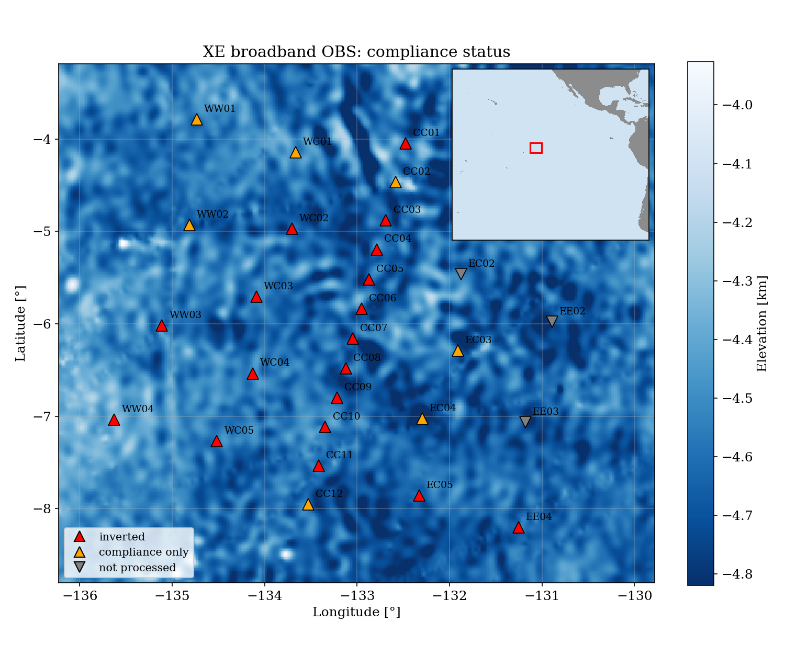</a></p>
<p align="center"><sub><b>XE network.</b> Red: inverted; orange: compliance only; grey: not processed.</sub></p>

### 2. Response removal and cleaning

Each channel is decimated with an anti-alias filter and the instrument response
is removed with an explicit pre-filter: acceleration or displacement for the
seismometer, pascals for the DPG. Ten-minute blocks containing a clipped or
flat sample are removed from all channels. Earthquakes are masked from the
global catalogue with TiSKitPy, and STA/LTA picks local events. No hourly
glitches were found on XE (fold strength below 2.0), so glitch removal is off
for this network.

```python
import tiskitpy

spans = tiskitpy.TimeSpans.from_eqs(
    (z.stats.starttime, z.stats.endtime),
    minmag=5.5,
    days_per_magnitude=0.5,
    save_eq_file=False,
)
```

<p align="center"><a href="docs/results/xe_young_orca_2026-11/figures/fig03_psd_stages.png">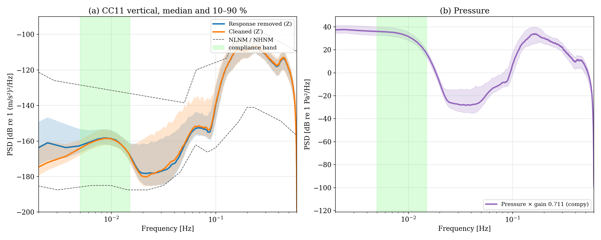</a></p>
<p align="center"><sub><b>XE.CC11 spectra.</b> (a) Vertical acceleration after response removal (blue) and after cleaning (orange), median and 10–90 %, with the Peterson noise models. (b) Calibrated pressure. Green: compliance band.</sub></p>

### 3. Tilt and coherent noise

Hourly tilt angles from TiSKitPy's `CleanRotator` are median-smoothed and
interpolated per sample. Horizontal-coherent noise is then removed from the
vertical only, in 24-h windows that avoid the earthquake spans.

```python
import compy
from compy import cleaning

rotated = cleaning.rotate_smoothly(st, hour_centres, angles, azimuths)
local = cleaning.sta_lta_spans(rotated.select(component="Z")[0])
cleaned = compy.remove_coherent_noise(rotated, 24, avoid_spans=spans, cover_all=True)
```

<p align="center"><a href="docs/results/xe_young_orca_2026-11/figures/fig04_tilt.png">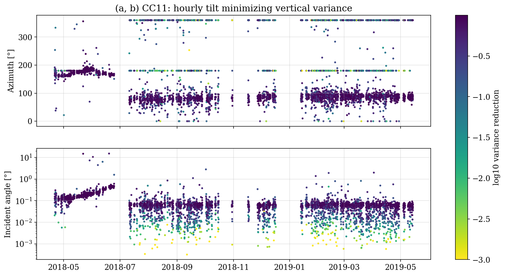</a></p>
<p align="center"><sub><b>XE.CC11 tilt.</b> Hourly azimuth and incidence angle that minimize vertical variance, coloured by variance reduction.</sub></p>

### 4. Pressure-gauge calibration

The DPG gain is fitted per teleseism by comparing the measured
pressure-to-acceleration ratio of the Rayleigh wave with the water-layer
prediction, in bins of high coherence. The station gain is the median of the
accepted events. For CC11 it is 0.711 ± 0.011 from 14 events, against 0.702
from the independent PressureQC microseism method.

```bash
python examples/3_DPG_Calibration.py SDS/ stationxml/ XE CC11 events.geojson
```

<p align="center"><a href="docs/results/xe_young_orca_2026-11/figures/fig05_calibration.png">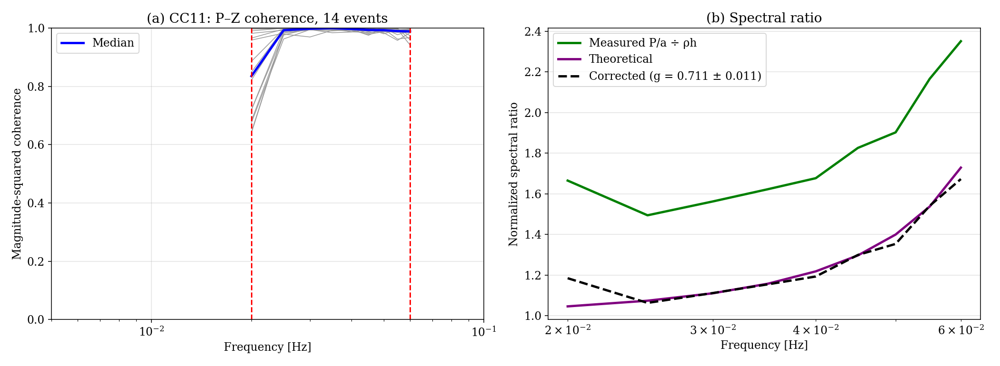</a></p>
<p align="center"><sub><b>XE.CC11 calibration.</b> P–Z coherence of the teleseisms and measured, theoretical and corrected spectral ratios; gain g = 0.711 ± 0.011 from 14 events.</sub></p>

### 5. Coherence and window selection

The cleaned record is cut into non-overlapping 35-min windows. A window is kept
when its median Z–P coherence in the compliance band exceeds 0.9 and its
pressure and acceleration levels lie inside the selection gates. CC11 keeps
7314 windows over 14 months. The band is the widest run of coherent bins below
0.8 f_c (kH = 4), where the pressure of the infragravity waves still reaches the
seafloor ([docs/COMPLIANCE_BAND.md](docs/COMPLIANCE_BAND.md)).

<p align="center"><a href="docs/results/xe_young_orca_2026-11/figures/fig06_coherogram.png">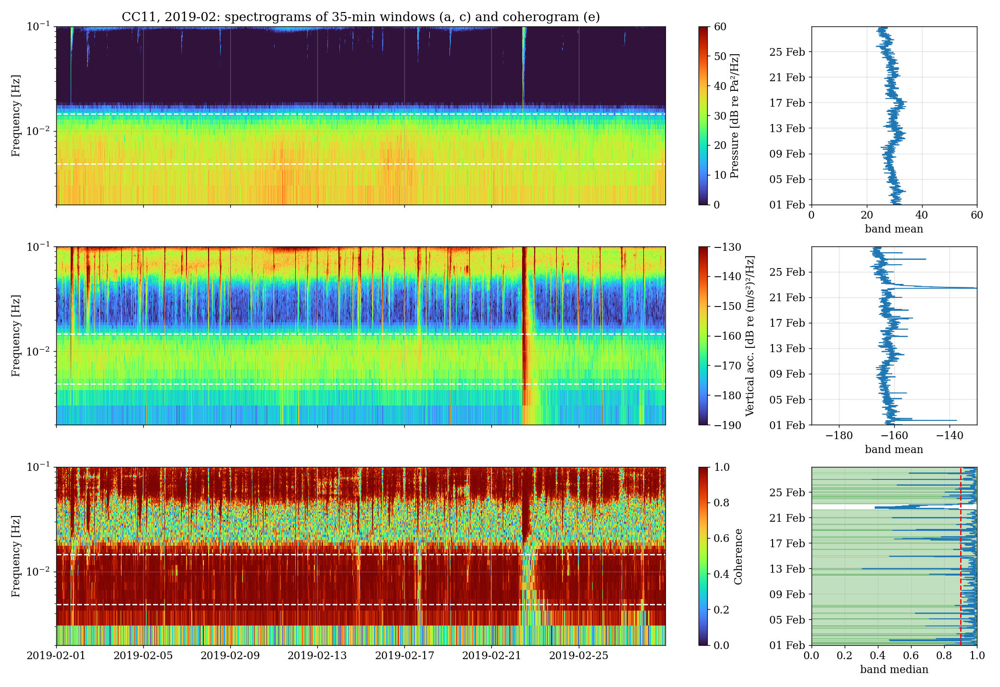</a></p>
<p align="center"><sub><b>XE.CC11, February 2019.</b> Pressure and vertical spectrograms and the Z–P coherogram of 35-min windows, with the band mean (or median) of each window on the right; dashed lines bound the compliance band, red the coherence threshold.</sub></p>

### 6. Compliance

Compliance comes from cross-spectra stacked over all selected windows, with
the gravity and wave-attraction corrections and the Bendat & Piersol error.
Monthly stacks give the data covariance and track changes in time. For CC11
the band is 4.9–14.6 mHz, the mean coherence 0.97, and the monthly stacks stay
within −0.9 % and +1.2 % of the full stack.

```python
from compy.compliance import GJI2025, stacked_compliance

pair = cleaned.select(channel="BHZ") + cleaned.select(channel="BDH")
windows = compy.split_stream(pair, 2100)  # 35-min windows
result = stacked_compliance(
    windows, 4636, 0.698, band=(0.0049, 0.0146), criteria=GJI2025, nseg=1024
)
result.compliance, result.uncertainty, result.n_windows
```

<p align="center"><a href="docs/results/xe_young_orca_2026-11/figures/fig07_windows.png">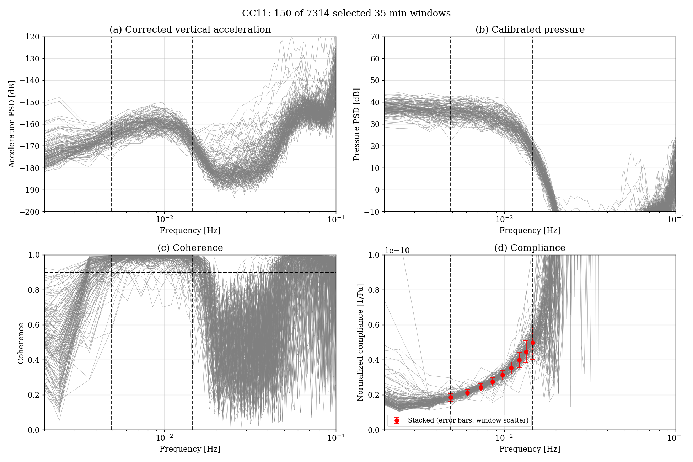</a></p>
<p align="center"><sub><b>XE.CC11 selected windows</b> (150 of 7314 shown): corrected vertical acceleration, calibrated pressure, coherence and per-window compliance with the stacked estimate (red).</sub></p>

### 7. Vs inversion

Since ComPy 1.3 the default is `compy.inversion.auto` ([docs/INVERSION.md](docs/INVERSION.md);
tests in [docs/inversion_overhaul_2026-11/REPORT.md](docs/inversion_overhaul_2026-11/REPORT.md)).
Compliance measures stiffness, so Vs follows only with Vp and density: both are
tied to Vs by rock relations with sampled factors. A soft-sediment unit, crustal
layers that double in thickness, a free Moho depth and a mantle half-space are
sampled with a prior about the CRUST1.0 model of the station (or a model you
give). Errors come from the bootstrap of the station's own windows plus terms for
the slope and level of the curve. Eight chains with parallel tempering run until
they converge.

```bash
compy-invert CC11_compliance_compy.npz --lat -7.5368 --lon -133.4166 --crust1 ~/crust1 --fetch-crust1
```

```python
from compy.inversion import auto, dram

model = auto.model_from_crust1(dram.crust1_column(-7.5368, -133.4166, "crust1"))
result = auto.invert(data, model, gain_sigma=0.05)  # data: auto.compliance_data(...)
result.quality(), result.profile()  # label with reasons; Vs, prior, resolved depths
```

<p align="center"><a href="docs/results/xe_young_orca_2026-11/figures/CC11_inversion.png">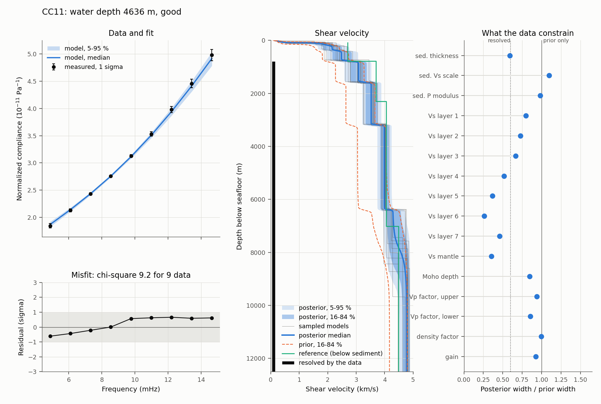</a></p>
<p align="center"><sub><b>XE.CC11, final model.</b> Data and fit (chi-square 9.2 for 9 data), Vs with its prior and the CRUST1.0 reference, and how much the data narrowed each parameter. The black bar marks the depths the data resolve. The Moho prior comes from the complete Bouguer anomaly and the sediment prior from DSDP Sites 73–75.</sub></p>

### 8. Vs profiles of the network

Each station is inverted alone; the profiles are then compared along the
lines of the array. XE.CC11, median (5–95 %):

| Depth below seafloor | Vs [m/s] |
|---|---|
| 0.5 km | 2484 (1962–3061) |
| 1 km | 3087 (2580–3526) |
| 2 km | 3526 (3209–3878) |
| 4 km | 3984 (3739–4240) |

Sediment 86 m (39–137), Vs at 2–5 km 3.81 km/s (3.57–4.05), Moho 8.0 km below
the seafloor (12.7 km below sea level).

<p align="center"><a href="docs/results/xe_young_orca_2026-11/figures/section.png">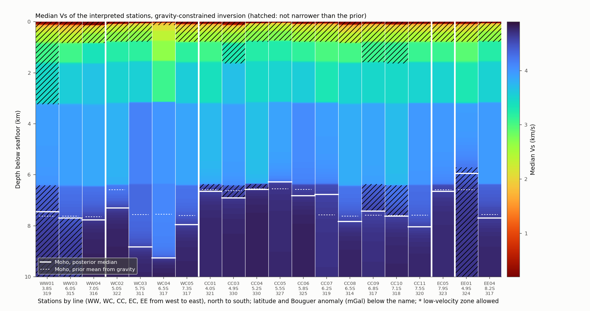</a></p>
<p align="center"><sub><b>XE network.</b> Median Vs of the 20 interpreted stations by line, west to east and north to south, with the Moho (white) and its gravity prior (dashed); hatched where the posterior is not narrower than the prior.</sub></p>

For slow and ultraslow ridges, where mantle rock reaches the seafloor, posterior
draws can be converted to a serpentinization upper bound with the Miller &
Christensen (1997) relation of Aminian et al. (2025, Fig. 10c): 0 % at 4.2 km/s
and 100 % at 2.2 km/s (`post.serpentinization_quantiles(z)`). It is not used on
the magmatic crust of XE.

## Results

### Pacific Array Young ORCA (XE), Pacific Ocean

30 stations on about 40 Ma seafloor at 4.4–4.8 km depth; 26 with compliance, 20 interpreted
(run of 13 and 16 November 2026).

- Compliance at 4.9–14.6 mHz with Z–P coherence up to 0.97 and thousands of
  windows per station; month-to-month variation of 1–3 %. CC07 changes after its
  seismometer dropped from the release arm (Eilon et al. 2021) and uses its stable period.
- Median of the interpreted stations: **Vs 3.75 km/s at 2–5 km** below the
  seafloor, 3.10 km/s at 0.7–1.5 km below the basement, 87 m of sediment, Moho
  7.4 km below the seafloor (12.0 km below sea level).
- Rayleigh-wave gains at 15 stations agree with the independent PressureQC
  microseism gains.

<p align="center"><a href="docs/results/xe_young_orca_2026-11/figures/map_results.png">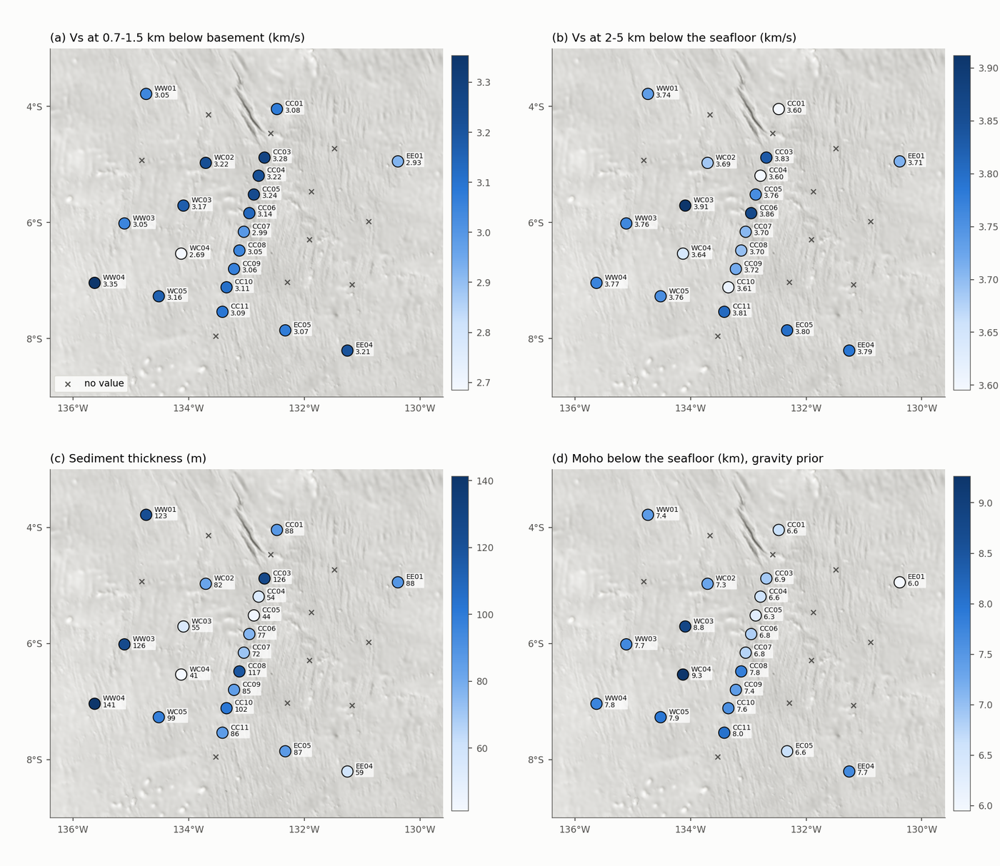</a></p>
<p align="center"><sub><b>XE results.</b> Vs at 0.7–1.5 km below the basement and at 2–5 km below the seafloor, sediment thickness, and Moho depth below the seafloor with the gravity prior.</sub></p>

<p align="center"><a href="docs/results/xe_young_orca_2026-11/figures/fig08_compliance.png">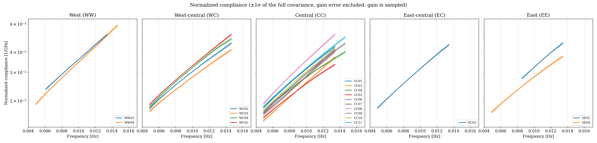</a></p>
<p align="center"><sub><b>XE compliance</b> by line, ±1σ of the full covariance.</sub></p>

Figures, numbers and the table of every station:
[docs/results/xe_young_orca_2026-11](docs/results/xe_young_orca_2026-11/README.md). The run of
29 October 2026 (ComPy 1.2.4–1.2.8) stays in
[docs/results/xe_young_orca_2026-10-29](docs/results/xe_young_orca_2026-10-29/README.md).

### The whole archive, 287 stations

Every OBS station of the archive with a seismometer, cleaned with ComPy 1.2.7 and
inverted with ComPy 1.3.0 (12 November 2026): 287 stations in 17 networks, 232
labelled good or usable, Vs at 2 km resolved at 170.

<p align="center"><a href="docs/results/whole_archive_2026-11/archive_vs_map.png">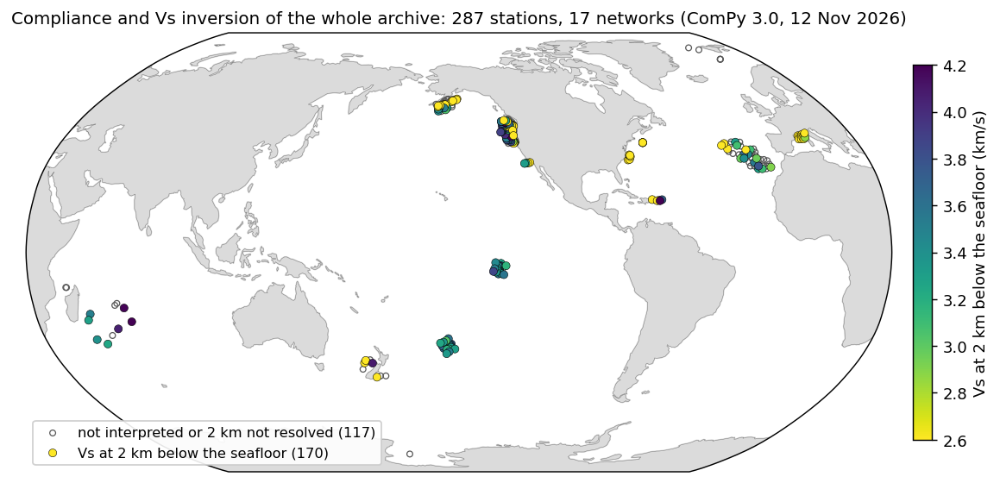</a></p>
<p align="center"><sub><b>Whole archive.</b> Vs at 2 km below the seafloor where the data resolve it; open circles: not interpreted or 2 km not resolved.</sub></p>

### Global pressure-noise atlas, 381 gauges

`compy-pressure-atlas` on the archive of November 2026: 975 pressure channels of 35
networks recomputed from the waveforms with one estimator (3-h windows, 0.02 to
1260 s). After the channel cascade and the screens, 381 gauges of 21 networks
(186 DPGs, 62 APGs, 133 hydrophones; 52 to 5788 m of water) enter the models
([docs/PRESSURE_ATLAS.md](docs/PRESSURE_ATLAS.md)).

<p align="center"><a href="docs/results/pressure_atlas_2026-11/global_density.png">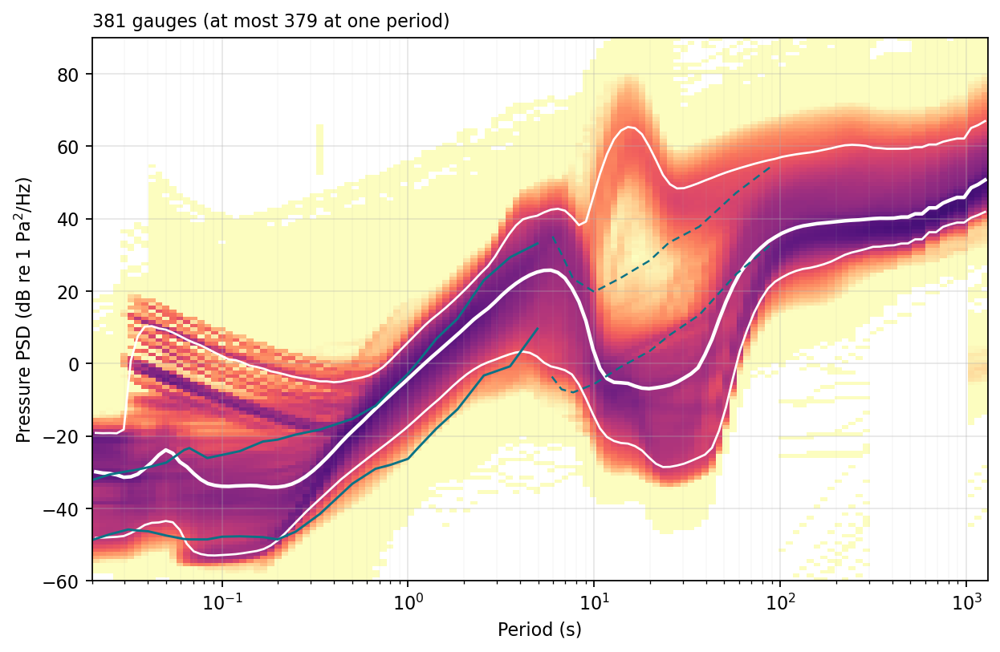</a></p>
<p align="center"><sub><b>Seafloor pressure noise, 381 gauges.</b> Station-balanced density of the 3-h spectra with the 5 %, median and 95 % models (white); teal: the low and high hydroacoustic noise models of the IDC (Brown et al. 2014, approximate digitization; dashed below 0.2 Hz). The microseism peak, the noise notch and the infragravity plateau; water depth sets where the plateau ends (kH = 4.4).</sub></p>

### RHUM-RUM (YV), Indian Ocean

Eight broadband stations, 2012–2013, the network of Aminian et al. (2025).
Final inversion: free Vp/Vs, gain sampled, stable and post-jump epochs inverted
together. Vs in m/s, median (5–95 %).

| Station | Setting | χ²/N | R-hat | Sediment [m] | Vs 0.5 km | Vs 1 km | Vs 2 km |
|---|---|---|---|---|---|---|---|
| RR28 | Somali plate | 2.9/6 | 1.012 | 311 (138–398) | 2157 (1450–3760) | 2789 (2150–3725) | 3421 (2910–3931) |
| RR29 | Somali plate | 2.9/5 | 1.005 | 91 (15–139) | 3186 (2333–4252) | 3426 (2709–4217) | 3678 (3106–4218) |
| RR34 | Somali plate | 2.4/6 | 1.008 | 219 (50–309) | 2258 (1723–3727) | 2811 (2203–3560) | 3185 (2757–3686) |
| RR36 | SWIR | 6.8/16 | 1.017 | 72 (10–143) | 2236 (1756–3320) | 2578 (2082–3094) | 3090 (2740–3594) |
| RR38 | SWIR | 33.0/12 | 1.015 | 224 (138–251) | 3062 (2307–4369) | 3722 (3025–4402) | 4058 (3697–4471) |
| RR40 | SWIR | 4.2/10 | 1.009 | 164 (40–219) | 2964 (2092–4165) | 3269 (2581–3978) | 3556 (3078–3994) |
| RR50 | Rodrigues TJ | 5.7/12 | 1.005 | 80 (14–112) | 3389 (2502–4346) | 3672 (2980–4363) | 3964 (3495–4429) |
| RR52 | CIR | 3.3/9 | 1.007 | 46 (6–81) | 2823 (2332–3632) | 3193 (2779–3672) | 3590 (3283–4013) |

RR38's pressure channel changes behaviour after its sensitivity jump, so RR38
is excluded from the interpretation. Figures, variants and full tables:
[docs/results/yv_inversion_2026-10-29](docs/results/yv_inversion_2026-10-29/README.md) and
[docs/results/yv_compliance_2026-10-28](docs/results/yv_compliance_2026-10-28/README.md).

## Repository structure

```text
ComPy/
├── compy/                   # the package
│   ├── streams.py           #   window splitting and stream checks
│   ├── cleaning.py          #   smooth tilt rotation, periodic transients, STA/LTA spans
│   ├── preprocessing.py     #   tilt correction, coherent-noise removal
│   ├── compliance.py        #   spectra, window selection, stacked compliance, errors
│   ├── inversion/           #   Vs inversion
│   │   ├── auto.py          #     default inversion (ComPy 1.3): invert, SeafloorModel, compy-invert
│   │   ├── errors.py        #     covariance of a stacked compliance curve from its windows
│   │   ├── dram.py          #     DRAM sampler, forward model, CRUST1.0, the 2.x model, serpentinization
│   │   ├── metropolis.py    #     Metropolis sampler of the GJI paper, tempering
│   │   ├── occam.py         #     Occam smooth-model inversion
│   │   ├── minimum_structure.py  # minimum-structure inversion after Crawford (2004)
│   │   ├── literature_mcmc.py    # Monte Carlo with Zha & Webb (2016), Zheng et al. (2024)
│   │   ├── impedance.py     #     independent forward model (surface impedance)
│   │   ├── propagator.py    #     forward model (Crawford's raydep) and kernels
│   │   └── models.py        #     starting and reference models
│   ├── diagnostics.py       #   R-hat, ESS, reproducible run records
│   ├── plotting/            #   style, spectra, inversion and QC figures
│   └── numerics.py          #   constants, gravity-wave dispersion, shared maths
├── inv_compy.py, ffplot.py, compy_*.py   # ComPy 1.2.x names (deprecated aliases)
├── compy_pressure/          # DPG QC, Rayleigh/microseism/local-P calibration, noise models
│   └── atlas/               #   global pressure-noise atlas: native-rate spectra, screens, models (compy-pressure-atlas)
├── pipeline/                # end-to-end network pipeline (stages A–G)
├── examples/                # offline synthetic examples and per-step scripts
├── tests/                   # pytest suite
├── docs/
│   ├── USER_GUIDE.md        # API reference
│   ├── INVERSION.md, PRESSURE.md, VALIDATION.md, ...
│   ├── images/              # logos and figures used by the documentation
│   ├── benchmark/           # CI inversion benchmark record
│   └── results/             # processed networks: scripts, figures, tables
│       ├── xe_young_orca_2026-11/      # latest Young ORCA run (README figures)
│       ├── whole_archive_2026-11/
│       ├── pressure_atlas_2026-11/
│       ├── xe_young_orca_2026-10-29/
│       ├── yv_compliance_2026-10-28/
│       └── yv_inversion_2026-10-29/
└── pressure/                # pressure-gauge campaign scripts, method notes and tests
```

## Documentation

| Document | Content |
|---|---|
| [Documentation index](docs/README.md) | All guides, method notes and results |
| [User guide](docs/USER_GUIDE.md) | Input conventions, estimators, inversion API, pressure QC, plotting |
| [Pipeline guide](pipeline/README.md) | Running a whole network, stages and configuration |
| [Examples](examples/README.md) | Offline synthetic examples and per-step scripts |
| [Inversion notes](docs/INVERSION.md) | Parameterization, sampler and validation |
| [Alternative inversions](docs/ALTERNATIVE_INVERSIONS.md) | The Moho rule, published Monte Carlo setups, Crawford's minimum-structure inversion |
| [Pressure tools](docs/PRESSURE.md) | `compy_pressure` commands and outputs |
| [Pressure atlas](docs/PRESSURE_ATLAS.md) | `compy-pressure-atlas`: native-rate spectra, screens, global noise models |
| [Compliance band](docs/COMPLIANCE_BAND.md) | Upper end of the band at kH = 4: papers, data, effect |
| [Validation](docs/VALIDATION.md) | Test coverage and scientific references |
| [Changelog](CHANGELOG.md) | Release history |

## Citation

If you use ComPy, please cite the article and the software version you used
([CITATION.cff](CITATION.cff), [Zenodo](https://zenodo.org/doi/10.5281/zenodo.13380107)).

```bibtex
@article{aminian2025shallow,
  author  = {Aminian, Mohammad Amin and Crawford, Wayne and Stutzmann, Éléonore
             and Montagner, Jean-Paul and Cannat, Mathilde and Hadziioannou, Céline},
  title   = {Shallow crustal structures of the Indian ocean derived from compliance function analysis},
  journal = {Geophysical Journal International},
  year    = {2025},
  volume  = {242},
  number  = {3},
  pages   = {ggaf253},
  doi     = {10.1093/gji/ggaf253}
}
```

## License and acknowledgments

ComPy is released under the [GPL-3.0](LICENSE). Contributions are welcome; see
[CONTRIBUTING.md](CONTRIBUTING.md).

**Author:** [Mohammad-Amin Aminian](https://orcid.org/0009-0001-9192-2734) ·
[LinkedIn](https://fr.linkedin.com/in/mohammad-amin-aminian-061b86298) ·
[Research software portfolio](PORTFOLIO.md)

Developed at the Institut de Physique du Globe de Paris with support from the
SPIN Innovative Training Network, funded by the European Commission under
Horizon 2020 Marie Skłodowska-Curie Actions.

<p align="center">


</p>

### Related software

- [OBS Transient Cleaner](https://github.com/MohammadAmin-Aminian/obs-transient-cleaner): periodic OBS instrument-transient removal.
- [ComPy Inversion Tuner](https://github.com/MohammadAmin-Aminian/compy-inversion-tuner): tuning of compliance-inversion controls.
- [RHUM-RUM Geospatial Mapper](https://github.com/MohammadAmin-Aminian/rhum-rum-geospatial-mapper): bathymetry, OBS-network and tectonic maps.
- [VRE Seismic Enhancement](https://github.com/MohammadAmin-Aminian/vre-seismic-enhancement): Virtual Resolution Enhancement for seismic sections.
- [Gabor Seismic Filter](https://github.com/MohammadAmin-Aminian/gabor-seismic-filter): orientation-selective 2-D seismic filtering.
