<p align="center"></p>

<h1 align="center">ComPy</h1>

<p align="center"><b>Seafloor compliance, pressure-gauge calibration and Bayesian shear-velocity inversion for broadband ocean-bottom seismometers.</b></p>

<p align="center">
<a href="https://github.com/MohammadAmin-Aminian/ComPy/actions/workflows/tests.yml"></a>
<a href="https://zenodo.org/doi/10.5281/zenodo.13380107"></a>
<a href="https://doi.org/10.1093/gji/ggaf253"></a>

<a href="LICENSE"></a>
<a href="https://orcid.org/0009-0001-9192-2734"></a>
</p>

ComPy turns raw ocean-bottom seismometer (OBS) and differential pressure gauge
(DPG) records into crustal shear-velocity models. It covers the full chain:
data cleaning, tilt and coherent-noise removal, Rayleigh-wave pressure
calibration, stacked compliance estimation and Bayesian inversion for Vs and
serpentinization. It was developed for the RHUM-RUM experiment in the Indian
Ocean ([Aminian et al. 2025, *GJI*](https://doi.org/10.1093/gji/ggaf253)) and
runs unattended on any broadband OBS network stored as an SDS archive.

<p align="center"><a href="docs/yv_inversion_2026-10-29/figures/paper_fig9_heatmaps.png">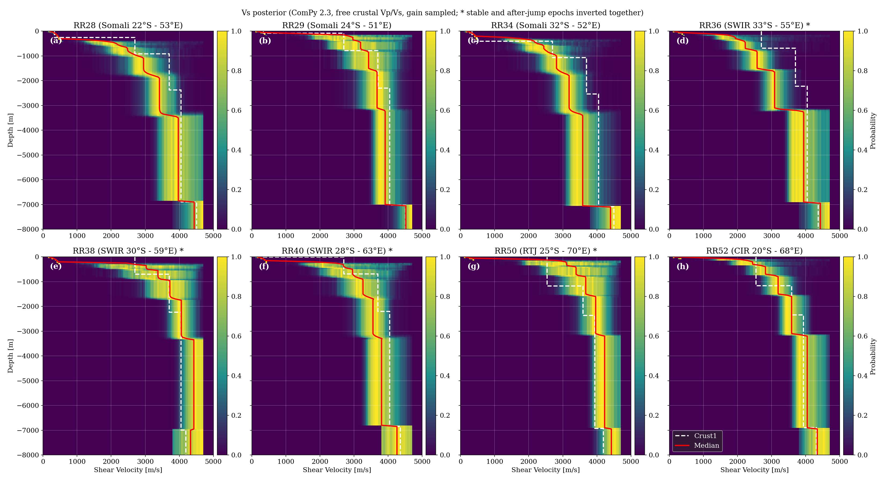</a></p>
<p align="center"><sub><b>Shear-velocity posteriors beneath the eight RHUM-RUM (YV) stations</b>, from the Somali plate to the Southwest, Central and Rodrigues ridges. Colour: posterior probability per depth row; red: median; white dashed: CRUST1.0.</sub></p>

## Contents

- [Highlights](#highlights)
- [Method](#method)
- [Installation](#installation)
- [Quick start](#quick-start)
- [Workflow, step by step](#workflow-step-by-step)
- [Results](#results)
- [Repository structure](#repository-structure)
- [Documentation](#documentation)
- [Citation](#citation)
- [License and acknowledgments](#license-and-acknowledgments)

## Highlights

- **End-to-end pipeline.** One command takes an SDS archive and StationXML to
  compliance, Vs models, figures and a report (`pipeline/run_pipeline.py`).
- **Stacked compliance with full error budget.** Cross-spectra stacked over
  non-overlapping windows, gravity and wave-attraction corrections, Bendat &
  Piersol errors and monthly stacks for the covariance.
- **Rayleigh-wave DPG calibration.** Per-event gains from teleseismic Rayleigh
  waves, cross-checked against microseism and local-P estimates
  (`compy_pressure`).
- **Bayesian inversion.** Multi-chain DRAM with parallel tempering, free Vp/Vs,
  the pressure gain sampled within ±5 %, R-hat/ESS diagnostics and sensitivity
  kernels; Numba-compiled forward model.
- **Two networks processed.** RHUM-RUM (YV, 8 stations, Indian Ocean) and
  Pacific Array Young ORCA (XE, 30 stations, Pacific).
- **Tested.** CI on Python 3.10–3.13 with lint, format, wheel build and an
  offline multi-chain benchmark.

## Method

Long-period seafloor pressure from infragravity waves deforms the crust. The
normalized compliance is the vertical displacement per unit pressure, scaled by
the water-wave wavenumber:

$$
\eta(\omega) = k(\omega)\,\frac{\left|S_{pz}(\omega)\right|}{S_{pp}(\omega)},
\qquad \omega^2 = g\,k\,\tanh(kH),
$$

where $S_{pz}$ and $S_{pp}$ are the pressure–displacement cross-spectrum and the
pressure auto-spectrum stacked over the selected windows, and $H$ is the water
depth. Low frequencies sense deeper structure, down to about one sixth of the
longest water wavelength. ComPy inverts η(ω) for a layered Vs model with a
propagator-matrix forward solver.

## Installation

Python 3.10 or later. With conda (recommended, for Numba):

```bash
git clone https://github.com/MohammadAmin-Aminian/ComPy.git
cd ComPy
conda env create -f environment.yml
conda activate compy
```

or with pip:

```bash
python -m venv .venv && source .venv/bin/activate
python -m pip install -e '.[dev,pressure,fast]'
python -m pytest -q
```

The distribution is `seafloor-compy`; the import names are `compy`,
`compy_processing`, `compy_inversion`, `inv_compy`, `ffplot` and the
`compy_pressure` package. Dependencies: NumPy, SciPy, Matplotlib, ObsPy,
TiSKitPy 2.3 and disba; Numba is optional and speeds up the inversion about
140×.

## Quick start

Offline synthetic inversion (seconds):

```bash
MPLBACKEND=Agg python _Example/synthetic_inversion.py
```

A full network run from an SDS archive:

```bash
export COMPY_RUN_DIR=~/runs/xe          # metadata/, work/, results/, logs/
python pipeline/run_pipeline.py CC11 CC05 --workers 8 --processes 8 --fetch
```

The pipeline runs stages A → G (preprocessing, cleaning, calibration,
compliance, inversion, figures, report) with checkpoints and a JSON run
manifest. All network-specific values live in `pipeline/config.py`; see the
[pipeline guide](pipeline/README.md).

## Workflow, step by step

Each step names its pipeline stage and the main function. Figures come from
station **XE.CC11** (Pacific Array Young ORCA, 4636 m) and station **YV.RR52**
(RHUM-RUM, Central Indian Ridge, 2918 m).

| Step | Stage | What it does |
|---|---|---|
| [1. Network and data](#1-network-and-data) | A | Read waveforms and StationXML responses |
| [2. Response removal and spectra](#2-response-removal-and-spectra) | A | Decimate, remove responses, drop clipped data |
| [3. Earthquakes and transients](#3-earthquakes-and-transients) | B | Mask earthquakes, remove periodic glitches |
| [4. Tilt and coherent noise](#4-tilt-and-coherent-noise) | B | Remove tilt and horizontal-coherent noise from Z |
| [5. Pressure-gauge calibration](#5-pressure-gauge-calibration) | D | Rayleigh-wave gain of each DPG |
| [6. Coherence and window selection](#6-coherence-and-window-selection) | C | Select windows with high Z–P coherence |
| [7. Compliance](#7-compliance) | C | Stacked compliance with errors and monthly stacks |
| [8. Bayesian Vs inversion](#8-bayesian-vs-inversion) | E | Multi-chain inversion for Vs and Vp/Vs |
| [9. Vs profiles and serpentinization](#9-vs-profiles-and-serpentinization) | F | Network profiles and serpentinization |

### 1. Network and data

Waveforms are read from an SDS archive with their full StationXML responses;
response epochs, units, timing and gaps are checked per station. The XE network
has 30 Scripps broadband OBS (Trillium 240 + DPG, 50 Hz) at 4386–4824 m water
depth, deployed April 2018 – May 2019 on ~40 Ma Pacific seafloor.

```bash
python pipeline/fetch_inventory.py && python pipeline/fetch_catalog.py
python pipeline/a_preprocess.py CC11 --workers 8
```

<p align="center"><a href="docs/xe_young_orca_2026-10-29/figures/fig01_map.png">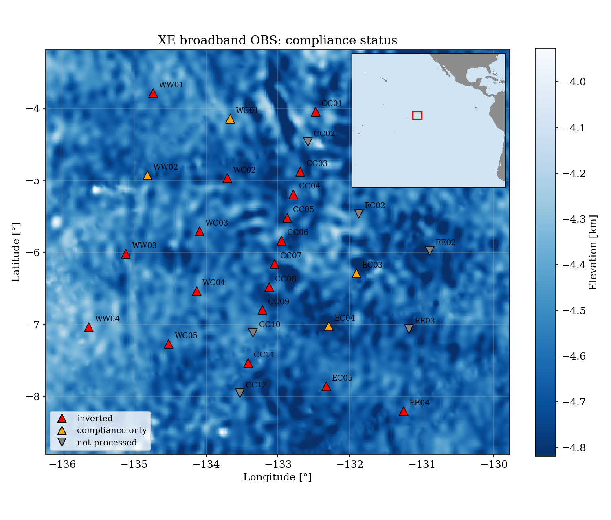</a></p>
<p align="center"><sub><b>XE network.</b> Red: inverted (20 stations); orange: compliance only; grey: not processed.</sub></p>

### 2. Response removal and spectra

Each channel is decimated with an anti-alias filter and the instrument response
is removed (displacement or acceleration for the seismometer, pascals for the
DPG) with an explicit pre-filter. Ten-minute blocks containing clipped or flat
samples are removed from all channels before decimation.

<p align="center"><a href="docs/xe_young_orca_2026-10-29/figures/fig03_psd_stages.png">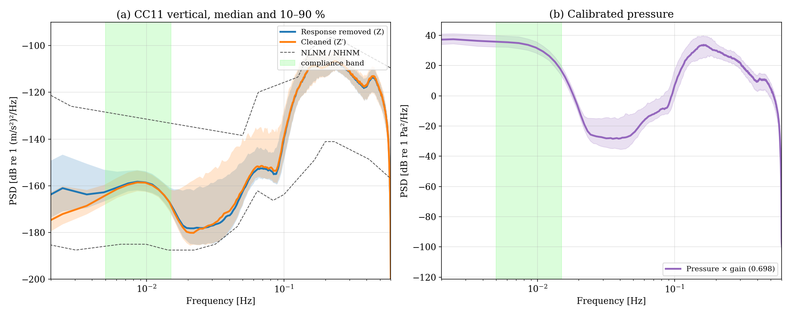</a></p>
<p align="center"><sub><b>XE.CC11 spectra.</b> (a) Vertical acceleration after response removal (blue) and after cleaning (orange), median and 10–90 %, with the Peterson noise models. (b) Calibrated pressure. Green: compliance band.</sub></p>

### 3. Earthquakes and transients

Earthquake intervals are masked from a global catalogue with TiSKitPy, and
periodic instrumental glitches are stacked and subtracted.

```python
import tiskitpy

spans = tiskitpy.TimeSpans.from_eqs(
    (z.stats.starttime, z.stats.endtime),
    minmag=5.5, days_per_magnitude=0.5, save_eq_file=False,
)
```

<p align="center"><a href="_Images/EQ_Removal.png">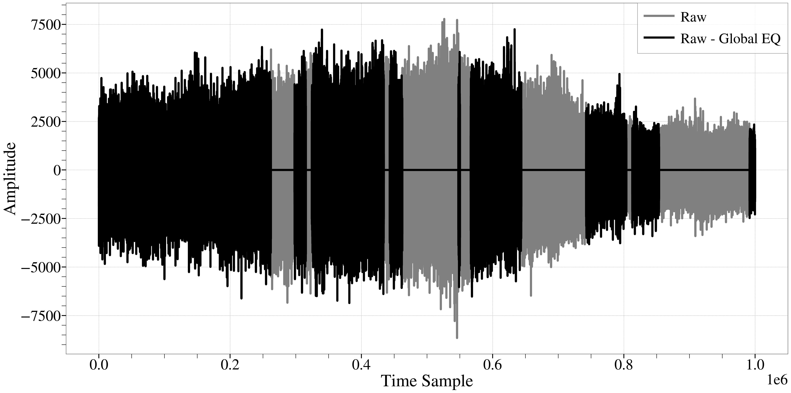</a></p>
<p align="center"><sub><b>YV.RR52 earthquake masking.</b> Intervals excluded before the transient estimate.</sub></p>

<p align="center"><a href="_Images/Glitch_Stack.png">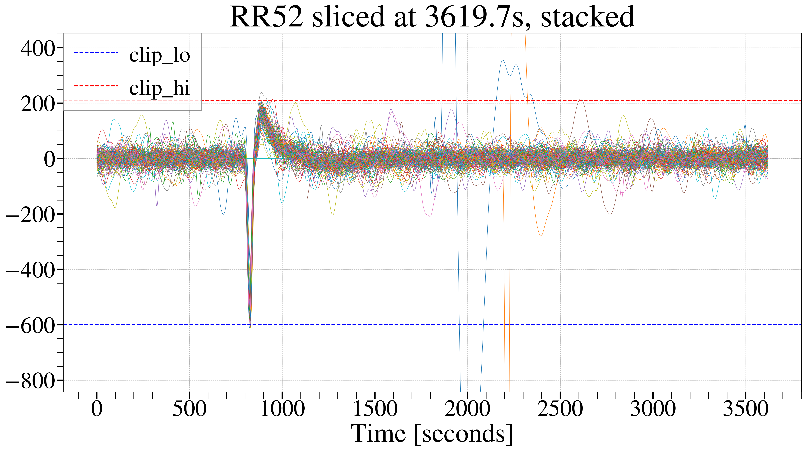</a></p>
<p align="center"><sub><b>YV.RR52 glitch stack.</b> Aligned slices of the hourly instrumental pulse; the clipping bounds define the samples used for its template.</sub></p>

### 4. Tilt and coherent noise

Hourly tilt angles from TiSKitPy's `CleanRotator` are median-smoothed and
interpolated per sample, then horizontal-coherent noise is removed from the
vertical only, in 24-h windows that avoid earthquakes.

```python
import compy, compy_cleaning as cleaning

rotated = cleaning.rotate_smoothly(st, hour_centres, angles, azimuths)
spans = cleaning.sta_lta_spans(rotated.select(component="Z")[0])
cleaned = compy.remove_coherent_noise(rotated, 24, avoid_spans=spans, cover_all=True)
```

<p align="center"><a href="docs/xe_young_orca_2026-10-29/figures/fig04_tilt.png">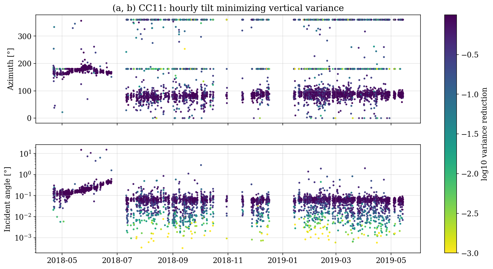</a></p>
<p align="center"><sub><b>XE.CC11 tilt.</b> Hourly azimuth and incidence angle that minimize vertical variance, coloured by variance reduction.</sub></p>

### 5. Pressure-gauge calibration

The DPG gain is fitted per teleseism (Mw ≥ 6) by comparing the measured
pressure-to-acceleration ratio of the Rayleigh wave with the water-layer
prediction, in bins with squared coherence ≥ 0.95. The station gain is the
median of the accepted events.

```bash
python _Example/3_DPG_Calibration.py SDS/ stationxml/ XE CC11 events.geojson
```

<p align="center"><a href="docs/xe_young_orca_2026-10-29/figures/fig05_calibration.png">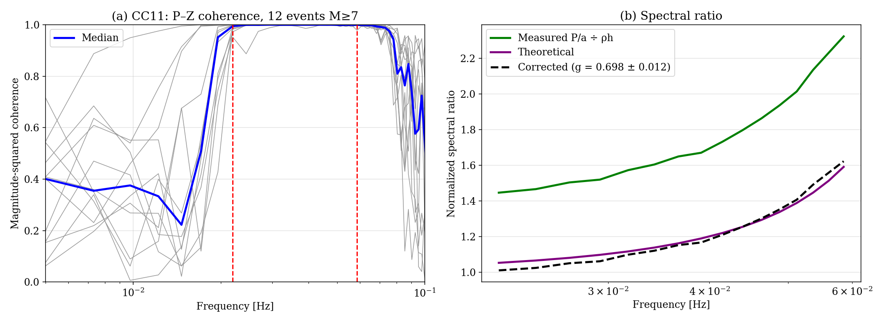</a></p>
<p align="center"><sub><b>XE.CC11 calibration.</b> (a) P–Z coherence of 12 teleseisms (M ≥ 7). (b) Measured, theoretical and corrected spectral ratios; gain g = 0.698 ± 0.012.</sub></p>

<p align="center"><a href="docs/yv_compliance_2026-10-28/figures/gain_comparison.png">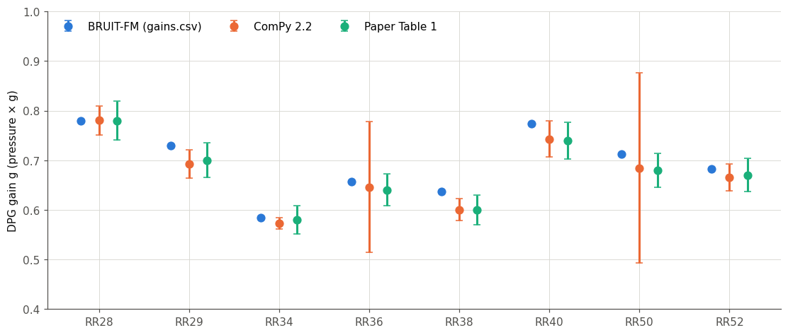</a></p>
<p align="center"><sub><b>YV gains.</b> ComPy Rayleigh-wave gains against the BRUIT-FM gains and Table 1 of Aminian et al. (2025).</sub></p>

### 6. Coherence and window selection

The record is cut into non-overlapping 35-min windows. A window is kept when
its median Z–P coherence in the compliance band exceeds the threshold
(0.9, or 0.8 for short records) and its pressure and acceleration levels lie inside the selection gates.

<p align="center"><a href="docs/xe_young_orca_2026-10-29/figures/fig06_coherogram_spectra.png">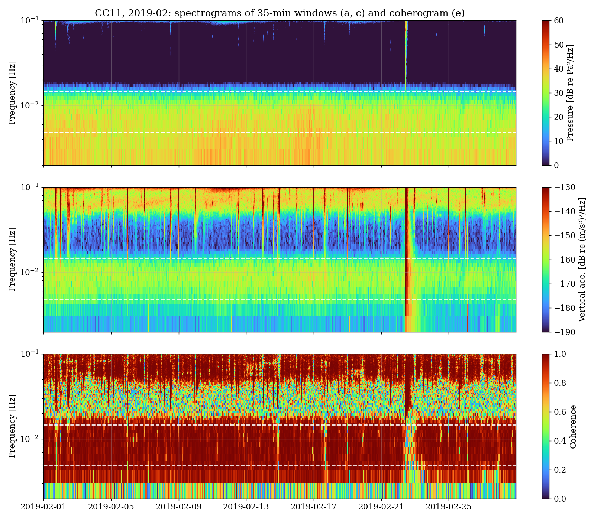</a></p>
<p align="center"><sub><b>XE.CC11, February 2019.</b> Pressure and vertical spectrograms and the Z–P coherogram; dashed lines bound the compliance band.</sub></p>

<p align="center"><a href="docs/xe_young_orca_2026-10-29/figures/fig07_windows.png">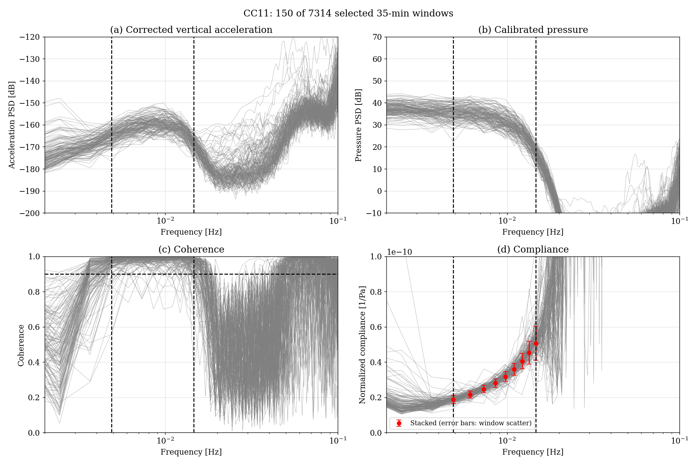</a></p>
<p align="center"><sub><b>XE.CC11 selected windows</b> (150 of 7314 shown): vertical and pressure spectra, coherence and per-window compliance with the stacked estimate.</sub></p>

### 7. Compliance

Compliance comes from cross-spectra stacked over all selected windows, with
the gravity and wave-attraction corrections and the Bendat & Piersol error.
Monthly stacks give the data covariance and track changes in time.

```python
from compy_processing import GJI2025, stacked_compliance

windows = compy.split_stream(cleaned.select(channel="BHZ") + cleaned.select(channel="BDH"), 2100)
result = stacked_compliance(windows, depth, gain, band=(0.007, 0.019), criteria=GJI2025, nseg=1024)
result.compliance, result.uncertainty, result.n_windows
```

<p align="center"><a href="docs/yv_compliance_2026-10-28/figures/RR52_compliance_panels.png">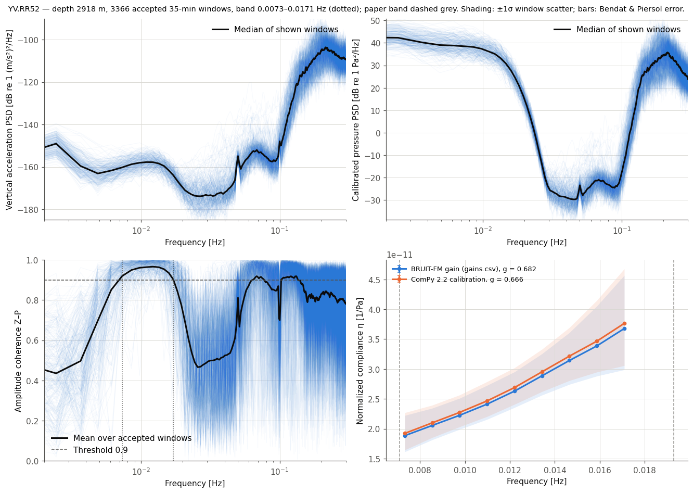</a></p>
<p align="center"><sub><b>YV.RR52 compliance</b> from 3366 windows, 7.3–17.1 mHz: vertical and pressure spectra, Z–P coherence and the stacked compliance.</sub></p>

<p align="center"><a href="docs/xe_young_orca_2026-10-29/figures/fig08_compliance.png">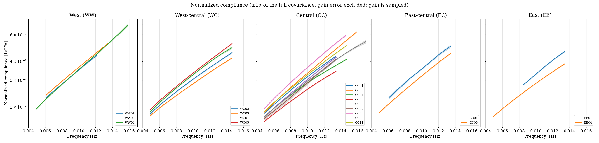</a></p>
<p align="center"><sub><b>XE network compliance</b> by sub-array, ±1σ of the full covariance.</sub></p>

### 8. Bayesian Vs inversion

The model is a Hamilton sediment layer of free thickness over crustal layers
that double in thickness down to the CRUST1.0 Moho, above a mantle half-space.
Eight DRAM chains with parallel tempering sample Vs, crustal Vp/Vs (free in
1.7–2.4), the smoothing weight and the pressure gain (±5 %).

```python
import compy_inversion as ci

data = ci.ComplianceData.from_npz("RR52_compliance_compy.npz", gain_rel=0.0, floor_rel=0.01)
model = ci.CrustalModel(moho_depth=moho, sediment_max=1000.0)
post = ci.sample(data, model, n_chains=8, n_iter=80000, n_burn=30000, gain_bounds=(0.95, 1.05))
post.summary()["max_rhat"], post.vs_quantiles(depths)
```

<p align="center"><a href="docs/yv_inversion_2026-10-29/figures/RR52_paper.png">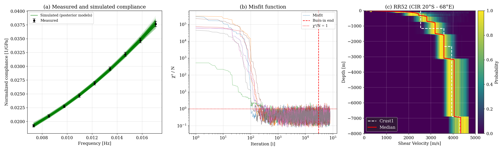</a></p>
<p align="center"><sub><b>YV.RR52 inversion.</b> (a) Measured compliance and posterior predictions. (b) Misfit of each chain; χ²/N = 3.3/9, R-hat 1.007. (c) Vs posterior with the median and CRUST1.0.</sub></p>

<p align="center"><a href="docs/xe_young_orca_2026-10-29/figures/fig09_heatmaps.png">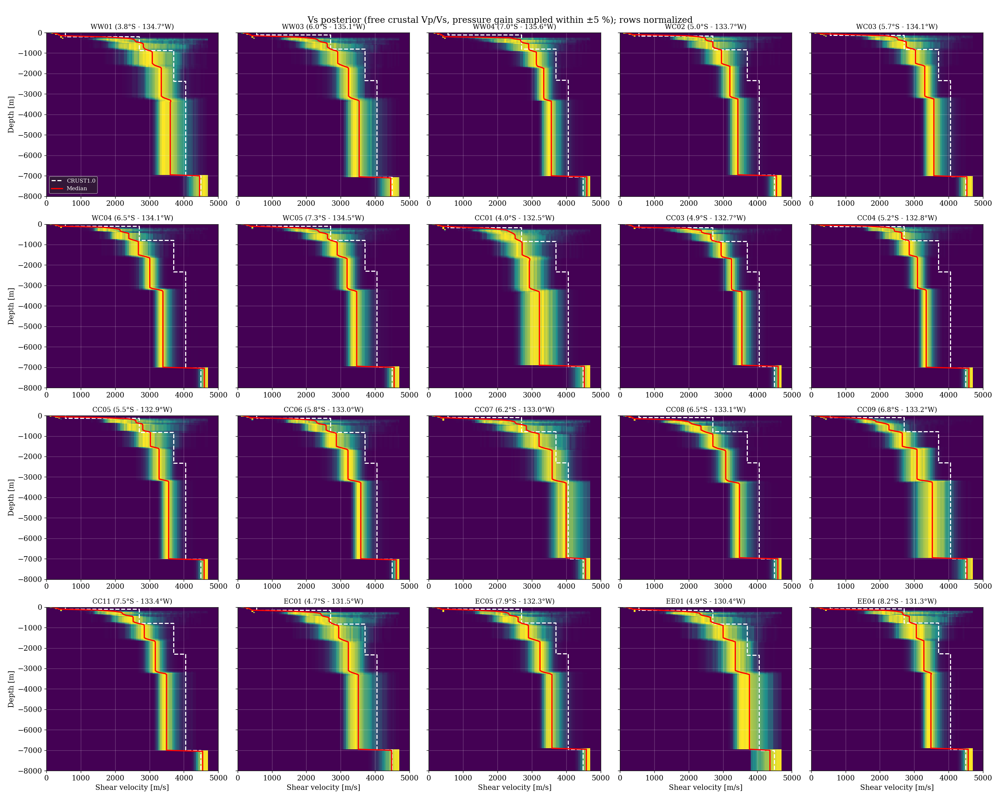</a></p>
<p align="center"><sub><b>XE Vs posteriors</b> for the 20 inverted stations.</sub></p>

### 9. Vs profiles and serpentinization

Posterior draws are pooled per region and converted to serpentinization with
the Miller & Christensen (1997) relation used in Aminian et al. (2025, Fig. 10c):
0 % at 4.2 km/s, 100 % at 2.2 km/s. The conversion attributes all of the
Vs reduction to serpentinization, so it gives an upper bound.

```python
beta_q = post.serpentinization_quantiles(z)   # (5 quantiles, len(z)) in %
```

<p align="center"><a href="docs/yv_inversion_2026-10-29/figures/paper_fig10_profiles.png">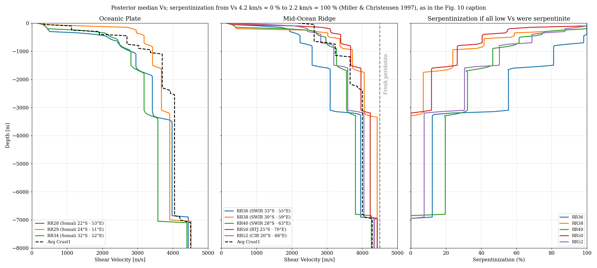</a></p>
<p align="center"><sub><b>YV.</b> Median Vs on the oceanic plate and at the ridges, and the corresponding serpentinization.</sub></p>

<p align="center"><a href="docs/xe_young_orca_2026-10-29/figures/fig10_profiles.png">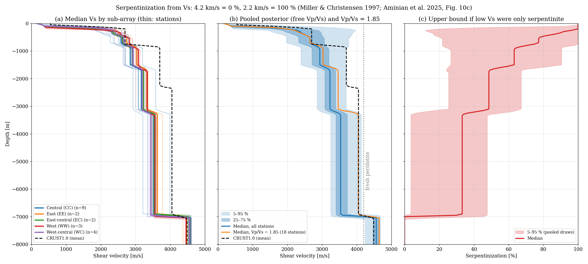</a></p>
<p align="center"><sub><b>XE.</b> Median Vs by sub-array, the pooled posterior (free Vp/Vs and Vp/Vs = 1.85) and the serpentinization upper bound.</sub></p>

## Results

### RHUM-RUM (YV), Indian Ocean

Eight broadband stations, 2012–2013. Final inversion: free Vp/Vs, gain
sampled, stable and post-jump epochs inverted together. Vs in m/s, median
(5–95 %).

| Station | Setting | χ²/N | R-hat | Sediment [m] | Vs 0.5 km | Vs 1 km | Vs 2 km |
|---|---|---|---|---|---|---|---|
| RR28 | Somali plate | 2.9/6 | 1.012 | 311 (138–398) | 2157 (1450–3760) | 2789 (2150–3725) | 3421 (2910–3931) |
| RR29 | Somali plate | 2.9/5 | 1.005 | 91 (15–139) | 3186 (2333–4252) | 3426 (2709–4217) | 3678 (3106–4218) |
| RR34 | Somali plate | 2.4/6 | 1.008 | 219 (50–309) | 2258 (1723–3727) | 2811 (2203–3560) | 3185 (2757–3686) |
| RR36 | SWIR | 6.8/16 | 1.017 | 72 (10–143) | 2236 (1756–3320) | 2578 (2082–3094) | 3090 (2740–3594) |
| RR38 | SWIR | 33.0/12 | 1.015 | 224 (138–251) | 3062 (2307–4369) | 3722 (3025–4402) | 4058 (3697–4471) |
| RR40 | SWIR | 4.2/10 | 1.009 | 164 (40–219) | 2964 (2092–4165) | 3269 (2581–3978) | 3556 (3078–3994) |
| RR50 | Rodrigues TJ | 5.7/12 | 1.005 | 80 (14–112) | 3389 (2502–4346) | 3672 (2980–4363) | 3964 (3495–4429) |
| RR52 | CIR | 3.3/9 | 1.007 | 46 (6–81) | 2823 (2332–3632) | 3193 (2779–3672) | 3590 (3283–4013) |

RR38's pressure channel changes behaviour after its sensitivity jump, so RR38
is excluded from the interpretation. Full tables, variants and figures:
[docs/yv_inversion_2026-10-29](docs/yv_inversion_2026-10-29/README.md) and
[docs/yv_compliance_2026-10-28](docs/yv_compliance_2026-10-28/README.md).

### Pacific Array Young ORCA (XE), Pacific Ocean

30 stations on ~40 Ma seafloor, 20 inverted, 18 with a Rayleigh-wave gain.

- Compliance at 4.9–14.6 mHz with Z–P coherence 0.93–0.97 and thousands of
  windows per station; month-to-month variation of 1–3 % (CC07: ±10–25 %).
- 80–170 m of sediment, then Vs of about 2.4 km/s at 0.3 km, 2.9 km/s at 1 km
  and 3.2 km/s at 2 km.
- Rayleigh-wave gains agree with the independent BRUIT-FM microseism gains
  (median ratio ≈ 0.99).

Full report (PDF, LaTeX source and tables):
[docs/xe_young_orca_2026-10-29](docs/xe_young_orca_2026-10-29/README.md).

## Repository structure

```text
ComPy/
├── compy.py                 # stream handling, rotation, coherent noise, legacy compliance
├── compy_processing.py      # stacked compliance, selection criteria, errors
├── compy_cleaning.py        # smooth tilt rotation, STA/LTA event spans
├── compy_inversion.py       # Bayesian Vs inversion, CRUST1.0, serpentinization
├── compy_numerics.py        # gravity-wave dispersion, constants
├── compy_diagnostics.py     # R-hat and ESS
├── compy_streams.py         # window splitting and stream checks
├── inv_compy.py             # forward propagator and legacy samplers
├── ffplot.py                # plotting
├── compy_pressure/          # DPG QC, Rayleigh/microseism/local-P calibration, noise models
├── pipeline/                # end-to-end network pipeline (stages A–G)
├── _Example/                # runnable examples, including offline synthetic runs
├── tests/                   # pytest suite
├── docs/                    # user guide, method notes and processed results
│   ├── yv_compliance_2026-10-28/
│   ├── yv_inversion_2026-10-29/
│   └── xe_young_orca_2026-10-29/
└── pressure/                # BRUIT-FM campaign scripts and tests
```

## Documentation

| Document | Content |
|---|---|
| [User guide](docs/USER_GUIDE.md) | Input conventions, estimators, inversion API, pressure QC, plotting |
| [Pipeline guide](pipeline/README.md) | Running a whole network, stages and configuration |
| [Inversion notes](docs/INVERSION.md) | Parameterization, sampler and validation |
| [Pressure tools](docs/PRESSURE.md) | `compy_pressure` commands and outputs |
| [Validation](docs/VALIDATION.md) | Test coverage and scientific references |
| [Changelog](CHANGELOG.md) | Release history |

## Citation

If you use ComPy, please cite the article and the software version you used
([CITATION.cff](CITATION.cff), [Zenodo](https://zenodo.org/doi/10.5281/zenodo.13380107)).

```bibtex
@article{aminian2025shallow,
  author  = {Aminian, Mohammad Amin and Crawford, Wayne and Stutzmann, Éléonore
             and Montagner, Jean-Paul and Cannat, Mathilde and Hadziioannou, Céline},
  title   = {Shallow crustal structures of the Indian ocean derived from compliance function analysis},
  journal = {Geophysical Journal International},
  year    = {2025},
  volume  = {242},
  number  = {3},
  pages   = {ggaf253},
  doi     = {10.1093/gji/ggaf253}
}
```

## License and acknowledgments

ComPy is released under the [GPL-3.0](LICENSE). Contributions are welcome; see
[CONTRIBUTING.md](CONTRIBUTING.md).

**Author:** [Mohammad-Amin Aminian](https://orcid.org/0009-0001-9192-2734) ·
[LinkedIn](https://fr.linkedin.com/in/mohammad-amin-aminian-061b86298) ·
[Research software portfolio](PORTFOLIO.md)

Developed at the Institut de Physique du Globe de Paris with support from the
SPIN Innovative Training Network, funded by the European Commission under
Horizon 2020 Marie Skłodowska-Curie Actions.

<p align="center">


</p>

### Related software

- [OBS Transient Cleaner](https://github.com/MohammadAmin-Aminian/obs-transient-cleaner): periodic OBS instrument-transient removal.
- [ComPy Inversion Tuner](https://github.com/MohammadAmin-Aminian/compy-inversion-tuner): tuning of compliance-inversion controls.
- [RHUM-RUM Geospatial Mapper](https://github.com/MohammadAmin-Aminian/rhum-rum-geospatial-mapper): bathymetry, OBS-network and tectonic maps.
- [VRE Seismic Enhancement](https://github.com/MohammadAmin-Aminian/vre-seismic-enhancement): Virtual Resolution Enhancement for seismic sections.
- [Gabor Seismic Filter](https://github.com/MohammadAmin-Aminian/gabor-seismic-filter): orientation-selective 2-D seismic filtering.
