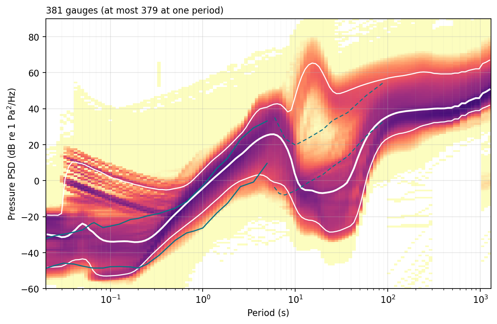
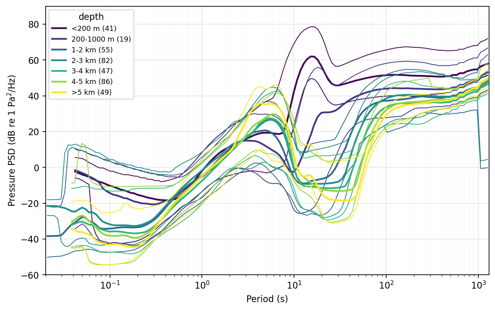
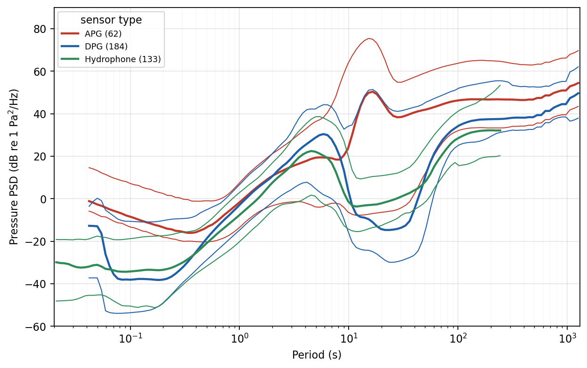

# Pressure atlas: global seafloor pressure-noise models (`compy_pressure.atlas`)

`compy-pressure-atlas` turns an archive of seafloor pressure gauges (differential pressure gauges, absolute
pressure gauges and hydrophones) into station-balanced noise models from 0.02 to 1260 s, stratified by water
depth, distance to the coast and to the shelf break, sensor type and brand, basin, latitude and season. It
replaces the analysis scripts of the November 2026 atlas (branch `analysis/pressure-atlas`, kept as an archive)
with one tested package.

## Three commands

```bash
# 1. native-rate spectra of every channel (one sequential reader of the archive, N workers; resumable)
compy-pressure-atlas native plan.csv --out native/ --cache /fast/disk/sds_cache --sds /Volumes/DATA/SDS --workers 4

# 2. distance of every gauge to the coastline and to the shelf break (Natural Earth 1:10 m, needs cartopy)
compy-pressure-atlas distances channels.csv --out channels_with_distances.csv

# 3. selection, screens, models and figures
compy-pressure-atlas build channels_with_distances.csv --out atlas/ --config atlas.json --workers 4
```

**Memory of `native`.** A worker holds the day files of one chunk at the native rate: about 3.7 GB on a 250 Hz
channel (measured over 260 days), 2 to 2.5 GB at 50 to 125 Hz, 1.4 GB at 40 Hz. Choose `--workers` so that workers
x 4 GB stays well below the memory of the machine. Thirteen workers on a 48 GB machine exhausted it when the
250 Hz channels came together (two kernel panics on 19 November 2026); the default is 4.

`plan.csv` has one row per channel: `seed_id`, `fs`, `xml` (StationXML with the response) and optionally `files`
(day files separated by `;`; otherwise `<sds>/<year>/<NET>/<STA>/<CHA>.D/*`). The channel table of `build` is
described in `compy_pressure/atlas/pipeline.py`; its required columns are the position, depth, sampling rate,
sensor type and brand, and the path of the native-rate file; optional columns carry the gain correction, the
usable band, upstream exclusions with their reason, the P-Z calibration level and the distances. A missing
optional column switches its step off. Every threshold is in `compy_pressure/atlas/config.py`; a JSON or YAML
file overrides any of them.

## One estimator from 0.02 to 1260 s (`native`)

Every channel is read at its own sampling rate. Windows of 3 h with 50 % overlap start on a fixed 1.5-h grid; a
window with a gap is not used. The PSD of a window is the Welch average of 2700-s Hann segments with 75 % overlap
(the ObsPy PPSD convention for that window), divided by the squared modulus of the full StationXML response and
averaged as power over 1/4-octave bands on the 1/8-octave grid of the atlas (nodes 1060 / 2^(j/8) s).

A channel with several response epochs is computed once per epoch; the day files at an epoch limit are computed
with both responses and each window keeps the response of the epoch that contains its start. Traces whose sampling
rate is not the rate of the plan are left out and counted (`traces_other_rate`); a channel with no window at the
plan's rate fails with that reason. Where the day files hold several location codes under one channel code, only
the code of the `seed_id` is read; a single code is read as it is, because data and metadata often disagree on it.

Periods shorter than 4 s come from the native samples; periods of 4 s and longer from the same window decimated to
1 Hz (zero-phase polyphase filter, flat to 0.4 Hz) and high-passed at 0.2 mHz over 6 h of context on each side,
which removes the tide before it can leak into the lowest Welch bins of absolute gauges. Above about 470 s a
1/4-octave band is narrower than the Welch resolution; there the level is interpolated between Welch bins.

Checks (`tests/test_pressure_atlas.py`):

- white noise of known level is recovered within 1.5 dB from the Nyquist band to 1260 s at 1 and 50 Hz (and
  within 1 dB at 62.5 and 250 Hz in the checks of the November 2026 run);
- a tide of 10^5 counts on 10-count white noise changes no period above 300 s by more than 1.5 dB;
- the vectorised Welch equals `scipy.signal.welch` to 1e-9.

On real data the product equals the 1.25 Hz product of ComPy stage A within 0.2 dB at 3-200 s (YV.RR01, 6360
windows), continues past 667 s where that product is cut by the stage A pre-filter, and does not suffer the
1-octave smoothing of the ObsPy PPSDs (which filled the 15-50 s notch by up to 7 dB).

**1-Hz channels** (most 7D LDH): the data fall by 34 dB between 2.9 and 2.3 s, a decimation filter that their
StationXML does not describe. They are used from 4 s (`population.one_hz_min_period_s`).

## Selection and screens (`build`)

1. **Channel cascade**, each step with its reason: no product; moored or unverified deployment; logger or unknown
   channel; input units not pressure; upstream exclusions (for example metadata known to be placeholders); fewer
   than 7 days; a second channel of the same gauge (the ?DH with the widest band is kept); a level more than 20 dB
   from the basin median at 1-2 s or 2.5-4 s (gross metadata errors); a P-Z calibration level more than 20 dB from
   the DPGs and APGs of the same depth class, or a network and sensor type whose median fails. The level gate
   judges every channel in both bands, also a hydrophone whose usable band ends below 2.5 s (in the November 2026
   archive this removes nine 1T and seven X3 hydrophone channels); `population.level_gate_usable_band_only: true`
   skips a gate band that lies outside the usable band of the channel. A channel without a gauge id is its own
   gauge. A missing or zero lower band limit means no limit.
2. **Window screens**: no level, clipped (99 % of 24-bit full scale, or 32-bit where most windows exceed 24 bits),
   dead (30 dB below the channel median), deployment edges (days at either end whose 1-10 s level departs by more
   than 15 dB; searched over the first and last 20 days and never over more than a third of the record).
3. **Day screen**: day levels against the same-day median of network peers of the same depth class (20 dB after the
   gauge's usual offset); deep gauges without peers against their own median (30 dB).
4. **Band screen**, gauges at 1000 m or deeper: a band median more than 25 dB from peers removes that band.

## Two limits per window (`band_rule`, rule W)

The usable band of a channel can be the one of the channel table (response 20-dB limit and validated hydrophone
cut-off; the atlas of November 2026) or rule W, selected with `population.band_rule = "W"` or the command
`compy-pressure-atlas band-rule TABLE --out TABLE_W.csv`. Rule W needs the native-rate file of each channel (column
`product`) for its response, and gives every window a low and a high frequency with a stated reason. A bin is kept when
its centre lies in `[f_lo, f_hi]` of its window; in the models the band has hard edges (no taper over the outer octave).

| Limit | Value | Source |
|---|---|---|
| high | `0.4 fs / 2^(1/8)` | sampling rate: the 1/4-octave bin stays under 0.8 Nyquist |
| high | frequency where the response of the epoch of the window is 3 dB under the nominal sensitivity | StationXML |
| high | self-noise cap by sensor type: highest frequency where the median of the type stays within 6 dB of the hydrophones (gauges deeper than 1000 m): APG 0.745 Hz, DPG 13 Hz, hydrophone none | the gauges (`empirical_caps`) |
| low | the 1/4-octave band holds one Welch bin of the 2700-s segment: a period of 468 s | estimator |
| low | a window without 6 h of context on each side has no level beyond 300 s | window |
| low | hydrophone: the cut-off validated on the pressure-vertical phase, else the response (-3 dB) | phase, StationXML |
| low | DPG: the response (-3 dB) and a period of at most 300 s (time constant implied by the data 241 s against 80 s in the metadata) | StationXML, gauges |
| low | APG: none | flat to DC |

The high limit is the lowest, the low limit the highest of its rows. The quantisation floor of the digitiser,
`-10 log10(6 fs) - 10 log10 |R|^2`, was checked and is at least 30 dB under the levels of every channel of the archive,
so it is not part of the rule. `empirical_caps` recomputes the self-noise caps from the median spectra of a new archive.

On the 381 gauges of the November 2026 archive the median spectrum moves by less than 0.5 dB between 0.3 and 20 s; the
gauges that cover 3-10 s stay 325, those that cover 15-50 s fall from 292 to 210, 100-170 s from 270 to 175 (networks
from 15 to 10), and no gauge covers 300-1000 s (the longest period kept is 468 s, for the APGs). Below 0.2 s only the
hydrophones remain, and the 95 % curve of the model falls by up to 30 dB there (the noise of the APGs and DPGs).
DPGs of other brands than SIO keep less: INSU 117 s, generic 78 s, LDEO 30 s (their responses fall 3 dB there).

## Models

Each gauge counts once. Its histogram of window levels, shifted by its gain, is normalised at each period and
weighted by its usable band (cos² taper over the outer octave). Percentiles of the sum give the group's 1-99 %
curves; a continuous piecewise-linear fit in log period with the fewest segments reaching 1 dB RMS gives the low
(5 %), median and high (95 %) models in the form of Peterson (1993), P = A + B log10 T. Curves are drawn only where
8 gauges count at full weight (3 for thin groups, flagged), and fitted only where a quarter of the group's gauges
count. Groups: all, deeper than 200 m, sensor type, depth class, sensor x depth, brand, basin, distance to the
coast, distance to the shelf break, latitude (each also restricted to gauges deeper than 1 km), season, hemisphere
and season, month by hemisphere, and the paired winter-minus-summer difference of each gauge.

## Results

The archive of November 2026: 975 pressure channels of 35 networks, recomputed at native rate (run of 18 to 20
November 2026, ComPy 1.3.2.0). The cascade and the screens leave 381 gauges of 21 networks in the models: 186
DPGs, 62 APGs and 133 hydrophones, between 52 and 5788 m of water, with 1.6 million 3-h windows. Against the
merged product used before (1-octave PPSDs joined to a 1.25 Hz product) the band levels of the common gauges
differ by 0.04 to 0.22 dB at the median between 3 and 170 s, and 376 of the 379 earlier gauges are kept.



*All gauges: station-balanced density of the 3-h spectra and the 5 %, median and 95 % models (white). Teal: the
low and high hydroacoustic noise models of the IDC (Brown et al. 2014, approximate digitization; dashed below
0.2 Hz).*



*Models by water depth (median thick, 5 and 95 % thin). The level of the notch and the period at which the
infragravity plateau ends follow the depth: the pressure is 20 dB below the plateau where kH = 4.4 (quartiles
4.0 to 4.5, 207 gauges deeper than 500 m).*



*Models by sensor type. The floor of the notch is the noise of the gauge: it is deepest for DPGs.*

The figures are the standard figures of `build` (`figures/` in the output folder).
