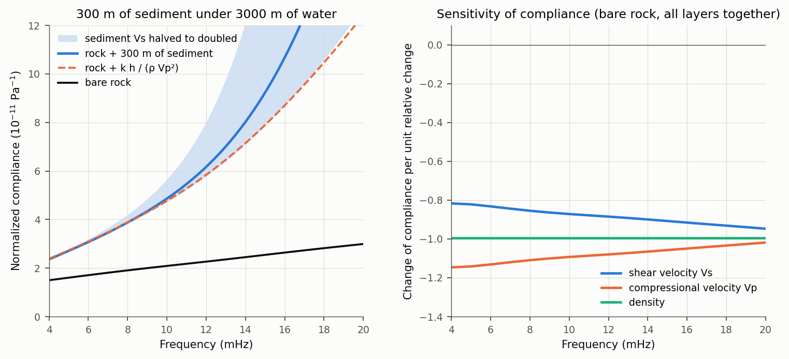
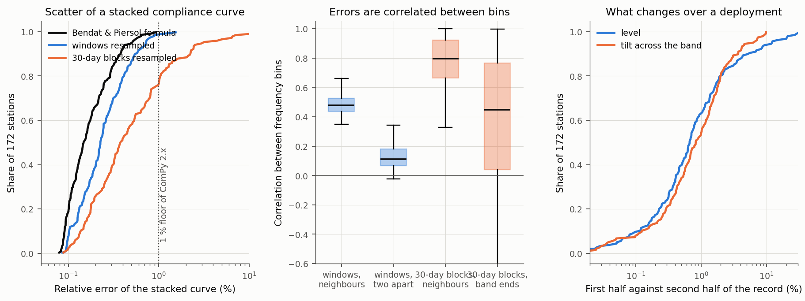
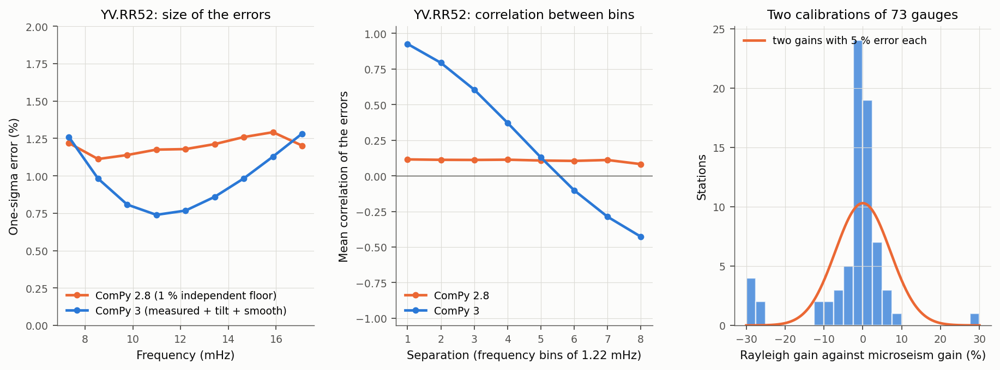
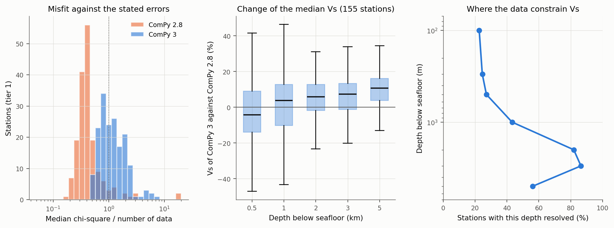
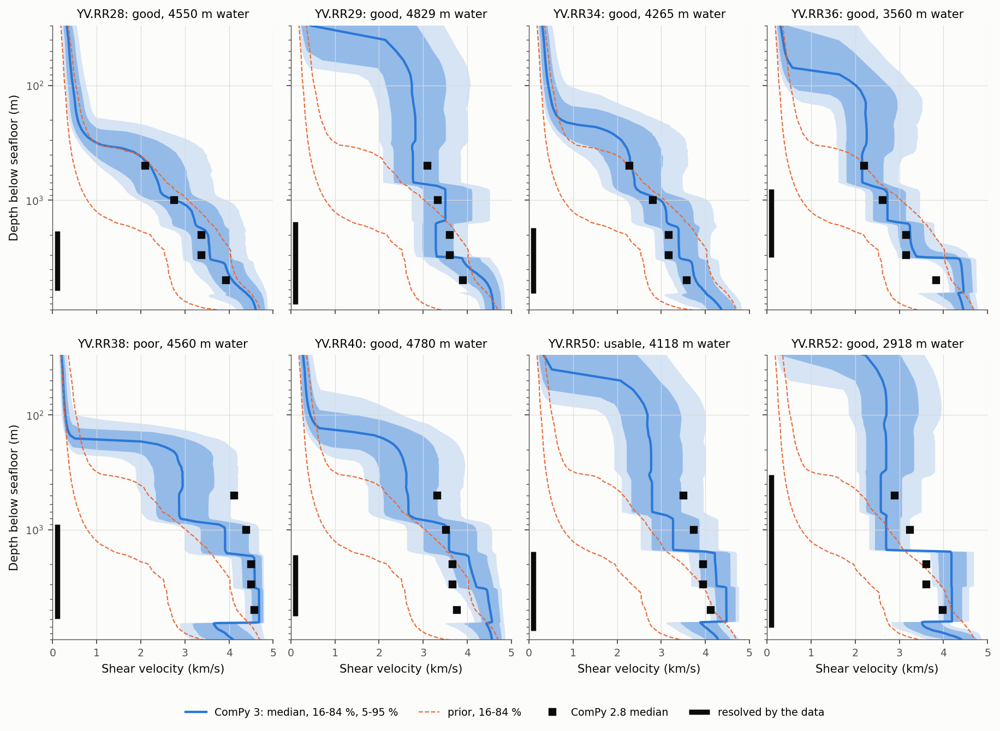
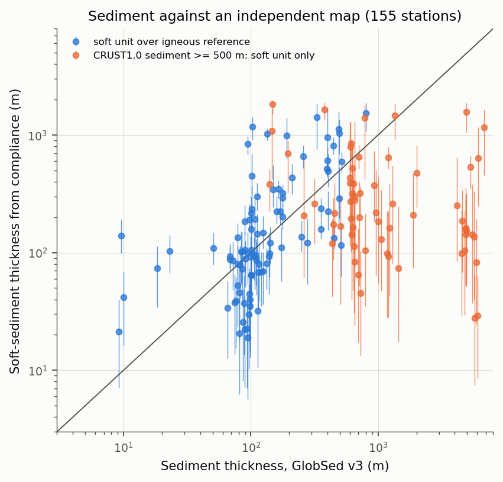

# ComPy inversion overhaul, November 2026

Audit and rebuild of the shear-velocity inversion of ComPy, against the primary literature and against tests that do not use any earlier ComPy result. Branch `inversion-overhaul`, proposed as ComPy 3.0.0. Brief: [PROMPT.md](PROMPT.md). Working notes: [NOTES.md](NOTES.md).

Every statement below is marked **[test]** (verified by a script in `scripts/`, output in `~/Desktop/ComPy/14_inversion_overhaul/`), **[source]** (taken from a publication that was read) or **[inferred]**.

## 1. Summary

**What was wrong in the inversion of ComPy 2.3 to 2.8**

1. **The error model.** Each frequency bin carried an independent 1 % error. The real scatter of a stacked compliance curve is 0.2 to 0.4 % and strongly correlated between bins; what is uncertain is the level of the curve (pressure gain) and its slope (pressure response at low frequency). The old model was five times too loose on the shape of the curve, which explains chi-square/N near 0.4, and too strict on its slope, which is what carries the information about the deep crust. [test]
2. **The prior.** Layers had a flat prior with a penalty on second differences. In the layers the data do not see, that penalty continues the shallow gradient and drives Vs to its bounds. This is the "deep layers press against their limits" of the earlier reports. [test]
3. **Vp and density.** Compliance measures stiffness, not Vs. One free Vp/Vs for all crustal layers settled near 2.1, which gives lower-crust Vp above 8.5 km/s and, with the density rule tied to Vp, a density of 3.3 g/cc. Both lower Vs: by about 10 % at 2 to 5 km. [test]
4. **Sediment.** A soft layer much thinner than the wavelength adds compliance through its P modulus, `k h / (rho Vp^2)`, whatever its Vs. The model fixed sediment density at 2.0 g/cc (soft sediment is nearer 1.6) and its Vp, and limited thickness to 1 km. Sediment thickness, and through it deep Vs, inherited those choices. [test]
5. **Fixed Moho** from a 1-degree model, and **uniform gain bounds** of 5 %, where two independent calibrations of the same gauges differ by more than that in one case out of six. [test]
6. **Band.** At shelf stations the estimate collapses above the frequency where the pressure signal still reaches the seafloor; the coherence gate does not detect it, and the saved curve was also cut at 40 mHz. Shelf station 7D.J09B never fitted for these reasons. [test]

**What was right.** The forward model (agreement with an independent 50-digit solution to 4e-7), the gravity corrections of the data (re-derived; the 2025 paper states their sign and size wrongly, the code is right), the sampler (acceptance rules read and tested; a ComPy 2.8 run repeats draw for draw), and the H1 estimator. [test]

**What changed.** A new default inversion, `compy.inversion.auto`, with errors measured from each station's own windows, a proper prior about a reference model, free Moho depth, Vp and density uncertain, sediment with its P modulus, a Gaussian gain prior, automatic band limits, sampling that repeats until it converges, and a result that marks the depths the data resolve. One command: `compy-invert`. Method: [../INVERSION.md](../INVERSION.md).

**Is it calibrated?** On synthetic data drawn from the prior, on four station types, the 50 % and 90 % intervals contain the truth at those rates (section 5). When the true Earth is one the model cannot represent, intervals stay honest below 700 m and Vs in the top 300 m follows the reference, not the data; the result flags those depths as unresolved. [test]

**What the data resolve.** At a deep-ocean station: the thickness of soft sediment, and broad averages of Vs between about 0.7 and 6 km. Not the top few hundred metres of basement, not thin layers, and nothing about Vp/Vs or density. [test]

**How much the Vs models moved** (archive rerun, 155 tier-1 stations that are not "poor"; ComPy 3 against ComPy 2.8, median and 16 to 84 % range):

| Depth | Change of median Vs | Stations with this depth resolved |
|---|---|---|
| 0.5 km | -4 % (-18 to +19) | 27 % |
| 1 km | +4 % (-18 to +18) | 43 % |
| 2 km | +6 % (-7 to +15) | 82 % |
| 3 km | +7 % (-5 to +17) | 86 % |
| 5 km | +11 % (-1 to +20) | 56 % |

Soft-sediment thickness is 0.76 times the 2.8 value (median). At the eight stations of the 2025 paper the change is larger: Vs at 2 to 3 km rises by 4 to 16 % at six of them and falls by 9 % at RR29; at RR38, RR40, RR50 and RR52 the new medians at 2 to 5 km are 4.1 to 4.7 km/s (section 7.2). These numbers compare two ComPy versions; neither is a reference.

**Confidence.** High for the diagnosis of the error model, the prior and the forward model: each rests on a test. Moderate for absolute Vs below 2 km: it depends on the Vp/Vs and density priors and on the slope allowance, whose sizes are judgements stated in section 4 and tested in sections 5 and 8. The independent sediment map agrees with the soft-sediment thickness where sediment is thin (rank correlation 0.66 over 92 stations, section 7.3).

**What failed or stays open** is in section 9; **decisions for the author and W. Crawford** in section 10.

## 2. Literature

| Source | Read | What was taken |
|---|---|---|
| Crawford (1994), PhD thesis, UCSD | ch. 2 and 6 (ch. 3 and 4 are placeholders in the PDF) | Half-space compliance, eq. 2.19; sensitivity ratios, eqs 2.20 to 2.22; Vp fixed from refraction; start Vs = Vp/1.87; density of Carlson & Raskin (1984), eq. 6.1; Occam inversion; sensitivity near lambda/6 |
| Crawford (2004), GJI 157 | in full | Definition, eq. 1; `eta = (lambda + 2 mu)/(2 mu (lambda + mu))`, eq. 5; "density has almost no effect"; depth between lambda/2pi and lambda/4; error formula, eq. 8; minimum-structure and Bayesian inversions; full equations of motion always solved |
| Zha (2014), PhD thesis, Columbia (holds Zha et al. 2014 and Zha & Webb 2016) | ch. 2 and 4 | Gravity correction as Crawford et al. (1998) eq. 6 without an errant 2 pi, sign of its effect; DRAM; sediment 0 to 2000 m with fixed Vs(z) (Ruan) and Vp(z) (Hamilton), density 2.0; crust layers 100 m doubling; Vp/Vs 1.85; density 1.85 + 0.165 Vp; mantle 3.8 to 4.2 km/s; Moho from refraction |
| Hulme et al. (2003, 2005); Crawford et al. (2002); Crawford (2005) | sections | 2-D effects, as a limit |
| Mosher et al. (2021), GJI 227 | sections | Another parameterization (Bernstein polynomials, constant Vp and density) |
| Janiszewski et al. (2019), GJI 217 | one statement | Sediment density 2.0 "following Ruan et al. (2014)" |
| Tsekhmistrenko et al. (2026), Seismica 5(2) | sections | Instruments of network 8J (for the 8J paper) |
| Aminian et al. (2025), GJI 242; Aminian (2024) thesis | earlier audits | The method under test |

**Not obtained** (publisher or host refused automated access, or closed): Crawford et al. (1991, 1998); Ruan et al. (2014); Bell et al. (2015); Doran & Laske (2019); Zheng et al. (2024); Brocher (2005), Hamilton (1976, 1979), Carlson & Raskin (1984), Christensen & Shaw (1970) in the original. Consequences: the Ruan sediment relation is not used; Brocher's relations are taken from a published implementation (R package hydrogeo) and marked so in the code; the 1998 gravity formula is taken from Zha's quotation and re-derived (section 3.1). Please check these against the originals.

## 3. Physics checks

### 3.1 Gravity terms of the data

With z up, a pressure p pushes the seafloor down, `u = -xi p`. A seismometer reads specific force, `a = d2u/dt2 - dg`. A wave crest attracts the mass upward, `dg = a_w = (2 pi G / g) cosh(kH) exp(-kH) p`; moving down by |u| raises gravity by the free-air gradient, `dg = (2g/R) u`. Hence `a/p = (omega^2 + 2g/R) xi - a_w/p`, and

`eta = k (omega^2 |Z/P| + a_w/p) / (omega^2 + 2g/R)`,

which is what `compy.compliance.gravity_corrected_compliance` computes. The correction raises compliance, as Zha et al. (2014) say. At YV.RR52 it is 18 % of compliance at 7.3 mHz and 6 % at 17 mHz. The 2025 paper says the attraction "can increase the measured compliance by up to 5 per cent": sign and size are wrong in the text, not in the code. The attraction of the displaced seafloor itself is a fifth of the free-air term, which is 0.3 % at 5 mHz: negligible. [inferred from first principles; formula of a_w from source]

### 3.2 Forward model

A global-matrix solver written for this audit (all layer amplitudes in one linear system, 50-digit arithmetic) agrees with `dram.Forward` to 3.6e-7 and with `impedance` to 2.8e-8 over 60 random models, half of them with slow sediment, under 150 to 5000 m of water. A gradient split into n sublayers converges as 1/n^2 (16 sublayers: 0.3 %). [test: `e01_forward_checks.py`]

### 3.3 What compliance is sensitive to

*Figure 1. Left: compliance of an oceanic crust under 3000 m of water without sediment (black) and with 300 m of sediment (blue); the dashed line adds only the uniaxial term k h/(rho Vp^2) to the bare rock; the band is the range when the sediment Vs is halved or doubled. Below 10 mHz the sediment acts through its P modulus alone. Right: change of compliance for a 1 % change of Vs, Vp or density in all layers. Read it as: compliance is about as sensitive to Vp as to Vs.*

- Half-space: `eta = (1 - nu)/mu`. Between Vp/Vs 1.73 and 2.4 the same compliance gives Vs 11 % apart. [source: Crawford 2004 eq. 5; arithmetic]
- Summed over a normal crust, `d ln eta/d ln Vs` is -0.80 to -0.96, `d ln eta/d ln Vp` -1.02 to -1.17, `d ln eta/d ln rho` -0.99. The published "2 to 9 times more sensitive to Vs" is per m/s. [test]
- Thin soft layer: 300 m of sediment adds 58 % (4 mHz) to 133 % (10 mHz) to bare-rock compliance; the added part equals `k h/(rho Vp^2)` to 3 % up to 10 mHz; halving the sediment Vs changes compliance by 1 % at 4 mHz and 3 % at 6 mHz. [test, both forward codes and the 50-digit solver]
- Attenuation: seismic velocities at 5 to 10 Hz exceed those at 10 mHz by `ln(700)/(pi Q)`: 0.4 % for Q = 500, 4 % for Q = 50, 10 % for Q = 20. Compliance Vs of sediment and of cracked upper crust should be read a few per cent below refraction Vs for this reason alone. [inferred: standard constant-Q dispersion, not re-read]

## 4. Errors of a compliance curve

*Figure 2. 172 stations of the archive. Left: share of stations whose stacked curve has at most the given relative error, by three measures; the dotted line is the 1 % floor of ComPy 2.x. Middle: correlation of the errors between frequency bins. Right: change of the level and of the tilt of the curve between the two halves of the record.*

| Quantity (172 stations) | Median [10 % to 90 %] |
|---|---|
| Bendat & Piersol error | 0.15 % [0.09 to 0.38] |
| Bootstrap over windows | 0.23 % [0.10 to 0.55]; 1.36 times Bendat & Piersol |
| Correlation of neighbouring bins; two apart | 0.48; 0.11 |
| Bootstrap over 30-day blocks | 0.38 % [0.14 to 2.2] |
| Share of the 30-day covariance that is a level / a tilt | 59 % / 11 % |
| First half against second half: level; tilt | 0.67 %; 0.83 % |
| H2/H1 of the stack | 1.09 |
| Compliance of the loudest fifth of windows over the quietest fifth | 0.985 [0.88 to 1.003] |

[test: `e02_error_model.py`; the restack equals the archive to 1.5e-14]

- **Estimator.** Noise on the pressure channel would make H1 rise with the pressure level. It falls slightly. So coherence is limited by noise on the vertical, H1 is the right estimator, and H2 (9 % higher) is not a useful bracket. The small fall is in the direction of the selection bias of the coherence gate found in the 2.9 audit. [test]
- **Gain.** The Rayleigh-wave gain and the microseism gain of 73 gauges differ by 2.7 % (robust scatter; 2.0 % for the 36 microseism pairs), with a 16 to 84 % range of -5.4 to +2.6 % and outliers beyond 25 %. A Gaussian prior of 5 % is supported; a hard +-5 % is not. [test]
- **Slope.** The tide-based correction of the pressure-gauge leak corner (2.9 audit) changes compliance by -3 % (median) at the bottom of the band, -6 % at YV.RR52. The allowance for a slope error is 2 % where that correction is applied, more where the tide and the phase estimate of it disagree, 4 % where no correction exists. This number is a judgement; section 5 shows what happens when it is exceeded. [inferred]

*Figure 3. Left and middle: the errors given to the inversion at YV.RR52 by ComPy 2.8 and by ComPy 3: their size, and their correlation between bins. Right: difference between two independent pressure calibrations; the curve is what two gains with 5 % error each would give.*

## 5. Calibration of the new inversion

Synthetic data sets, 144 per case: a true model is drawn, its compliance computed, noise added with the station's covariance, and the result inverted (`e03_sbc.py`). For 144 cases a correct 50 % interval contains the truth in 42 to 58 % of them and a 90 % interval in 85 to 94 %.

| Case | Parameters within both ranges | Vs at 8 depths, 50 % | Vs, 90 % | Median bias of Vs |
|---|---|---|---|---|
| Truth from the prior, YV.RR52 (deep, 9 data) | 15 of 16 | 0.39 to 0.60 | 0.83 to 0.92 | -1.1 to +0.4 % |
| Truth from the prior, 7B.NN04 (abyssal, 8 data) | 15 of 16 | 0.45 to 0.54 | 0.85 to 0.91 | -2.4 to +0.7 % |
| Truth from the prior, 7K.AN3 (slope, thick sediment, 13 data) | 15 of 17 | 0.46 to 0.55 | 0.88 to 0.94 | -1.4 to +1.4 % |
| Truth from the prior, 7D.J09B (shelf, 23 data) | 17 of 18 | 0.42 to 0.55 | 0.90 to 0.94 | -2.9 to +0.9 % |
| Smooth-gradient Earth the layers cannot represent, RR52 | n/a | 0.49 to 0.78 from 700 m down; 0.40 to 0.53 above 300 m | 0.97 to 1.00 from 700 m down; 0.66 to 0.94 above 300 m | -3.0 to +1.9 % from 700 m down; +16 to +25 % above 300 m |
| The same, NN04 | n/a | 0.51 to 0.79; 0.35 to 0.50 | 0.91 to 1.00; 0.72 to 0.95 | -5.3 to +8.3 %; +16 to +26 % |
| Unmodelled slope error of 4 %, RR52 | 15 of 16 | 0.37 to 0.59 | 0.82 to 0.92 | -2.8 % at 50 m to +7.0 % at 7 km |
| Gain error of 10 % (twice the prior), RR52 | 13 of 16 (the gain itself: 0.17 and 0.56) | 0.33 to 0.50 | 0.78 to 0.88 | -1.4 to +0.8 % |

[test; full numbers in `e03_sbc/summary.json`]

Reading:

- With the truth drawn from the prior, coverage is nominal for every parameter type on all four station types. Five of 67 parameter rows fall just outside one of the two ranges (coverage 0.83 to 0.95 against 0.85 to 0.94, or 0.59 to 0.60 against 0.58), which is what chance gives for this many rows.
- With an Earth of smooth gradients, a depth-dependent Vp/Vs between 1.76 and 2.5 and another density rule, intervals below 700 m are conservative and the median error of Vs is 2 to 9 %. In the top 300 m the truth has a slow layer 2A, the reference does not, and the data cannot tell: Vs there is the reference. These are the depths the result marks as unresolved.
- A slope error twice the allowance biases Vs below 3 km by 2 to 7 %. This is the main systematic risk of deep Vs.

## 6. The earlier sampler still repeats

Variant `final` of ComPy 2.8 at YV.RR52, run with the ComPy 3 code, gives the archived draws exactly (maximum difference 0.0 over 8 x 5000 x 10 values). The additions to the sampler do not change a 2.x run. [test: `c01_legacy_identity.py`]

## 7. Rerun of the archive

All 287 stations with at least 100 compliance windows, with the wide-gate stage C results of the archive, covariances from the per-window spectra cache, and the tide-based response correction where the 2.9 audit has a leak factor (168 stations). Output: `~/Desktop/ComPy/14_inversion_overhaul/r01_archive/` (`tables/results_auto.csv`, one folder and one figure per station). Nothing earlier was overwritten. Total sampling time 5.5 hours of two stations at a time on six cores each; median 33 s per station; 141 of 172 tier-1 stations converged in the first round, 22 in the second, 9 used the third. [test]

### 7.1 Quality

| | good | usable | poor |
|---|---|---|---|
| Tier 1 (172, for interpretation) | 135 | 20 | 17 |
| Tier 2 (115, nominal or doubtful gains, shallow water) | 57 | 20 | 38 |

Reasons given for the 95 stations that are not "good" (a station can have several): misfit 63; no depth resolved 29; gain pulled more than 2 sigma 21 (17 of them nominal gains); not converged after three rounds 17; a Vp factor pulled 17; a resolved layer at a bound 6; density factor pulled 3. Of the 154 tier-1 stations that ComPy 2.8 called good, 127 are good, 19 usable and 8 poor now.

Median chi-square per datum is 1.08 (tier 1), against 0.38 in the 2.8 run: the stated errors now match the misfit.

*Figure 5. Tier 1. Left: median chi-square divided by the number of data, for the 2.8 run and the new run; 1 is what correct errors give. Middle: change of the median Vs between the two runs at five depths (box: quartiles, whiskers: range without outliers). Right: share of stations at which each depth counts as resolved.*

### 7.2 The eight stations of the 2025 paper

*Figure 4. Vs against depth (logarithmic) at the YV stations. Blue: ComPy 3 posterior. Orange dashed: its prior. Black squares: medians of ComPy 2.8 at 0.5, 1, 2, 3 and 5 km. Black bar: depths resolved by the data. Where the bar is absent the blue band is the prior.*

Median Vs in km/s with the 16 to 84 % interval; the 2.8 median in brackets; "u" marks an unresolved depth.

| Station | Label | Soft sediment (m) | 1 km | 2 km | 3 km | 5 km |
|---|---|---|---|---|---|---|
| RR28 | good | 342 (242 to 555) | 2.79 u (2.25 to 3.45) [2.76] | 3.52 (3.11 to 3.99) [3.37] | 3.56 (3.17 to 4.05) [3.37] | 4.08 (3.65 to 4.51) [3.93] |
| RR29 | good | 32 (11 to 60) | 3.51 u (3.00 to 4.11) [3.34] | 3.29 (2.98 to 3.68) [3.61] | 3.30 (3.00 to 3.72) [3.61] | 4.40 (3.95 to 4.66) [3.91] |
| RR34 | good | 223 (154 to 332) | 2.99 u (2.48 to 3.61) [2.81] | 3.40 (3.04 to 3.83) [3.17] | 3.41 (3.06 to 3.84) [3.17] | 3.78 (3.43 to 4.17) [3.58] |
| RR36 | good | 73 (34 to 113) | 2.73 (2.40 to 3.14) [2.62] | 3.25 (2.97 to 3.56) [3.15] | 3.37 (3.09 to 4.29) [3.15] | 4.44 u (4.23 to 4.65) [3.84] |
| RR38 | poor (misfit 26.6 for 6 data) | 163 (130 to 201) | 3.91 (3.35 to 4.44) [4.39] | 4.58 (4.28 to 4.74) [4.50] | 4.59 (4.30 to 4.74) [4.50] | 4.68 (4.51 to 4.77) [4.57] |
| RR40 | good | 140 (98 to 190) | 3.58 u (2.99 to 4.20) [3.52] | 4.06 (3.64 to 4.47) [3.66] | 4.19 (3.79 to 4.58) [3.66] | 4.52 (4.26 to 4.72) [3.77] |
| RR50 | usable (misfit 15.4 for 6 data) | 42 (16 to 69) | 3.27 u (2.78 to 3.86) [3.73] | 4.23 (3.87 to 4.56) [3.95] | 4.25 (3.89 to 4.57) [3.95] | 4.48 (4.24 to 4.68) [4.12] |
| RR52 | good | 21 (7 to 40) | 2.70 (2.44 to 3.02) [3.24] | 4.18 (3.89 to 4.52) [3.61] | 4.18 (3.90 to 4.52) [3.61] | 4.19 (3.99 to 4.42) [3.98] |

Three things to read from this table:

- **Vs of 4.1 to 4.6 km/s between 2 and 5 km at RR38, RR40, RR50 and RR52 is faster than gabbro** (3.7 to 3.9 km/s) and close to unaltered peridotite. It is not a general feature of the method: among the 76 deep tier-1 stations of the archive the median Vs at 3 km is 3.37 km/s (16 to 84 %: 3.11 to 3.67) and only 5 % exceed 4.0 km/s. So either these sites have thin crust or shallow ultramafic rock, which is plausible on the ultraslow Southwest Indian Ridge and near the Rodrigues triple junction, or the low-frequency compliance of the YV instruments is too low by a few per cent for a reason not yet identified. A slope error of 3 % moves Vs at these depths by about 6 %. This needs the judgement of people who know the sites and the instruments. [inferred]
- **About half of the rise against 2.8 is the Vp and density rule**, not the data: 2.8 sampled one Vp/Vs for all layers and found about 2.1, and its density followed that Vp. [test: section 8]
- **The top kilometre is mostly unresolved** at these depths of water; values there are the prior.

The published profiles of the 2025 paper were not used anywhere in this work. How they compare with the table above is for the author to judge; ComPy 2.8 already differed from them (docs/INVERSION_2x.md).

### 7.3 Sediment against an independent map

*Figure 6. Thickness of the soft-sediment unit from compliance against total sediment thickness of GlobSed v3 (Straume et al. 2019) at the same position, tier-1 stations that are not poor. Blue: stations where the whole sediment column is the soft unit. Orange: stations where CRUST1.0 has at least 500 m of sediment, whose consolidated part is in the layered reference, so the soft unit is only its top. The line is equality.*

GlobSed was not used by the inversion. For the 92 stations on thin sediment the rank correlation is 0.66 (p = 6e-13), the median ratio compliance/GlobSed is 1.09, and 79 % agree within a factor of 3. This supports the sediment term of the model, including its P modulus. The compliance thickness is a thickness of soft material: on young crust with 10 m of mapped sediment it gives 20 to 160 m, which is more likely rubble and porous lava than sediment. [test: `v01_globsed.py`, `g02_figures_results.py`]

No comparison with published compliance results of other groups at the same stations was made: Ruan et al. (2014), Bell et al. (2015) and Doran & Laske (2019) could not be obtained.

SENSITIVITY_PLACEHOLDER

## 9. What failed, and what stays open

| Item of the brief (section 3) | Status |
|---|---|
| Errors look too wide (chi-square/N 0.39) | Resolved: independent 1 % floor against 0.2 to 0.4 % correlated scatter. Now 1.08. [test] |
| Vs depends on the Vp and density rule | Explained (compliance measures stiffness) and handled by priors with sampled factors. Not removable: absolute Vs carries this assumption. A measured Vp profile can be given as the reference. |
| Vs depends on the method (minimum structure against Bayesian) | Not re-run. The minimum-structure code fixes Vp, density and the half-space and has no sediment P-modulus term; with the findings here the two answer different questions. Open. |
| Deep parameters press against their limits | Explained by the second-difference smoothing prior; gone with the proper prior, except where the data themselves ask for it (section 7.2). [test] |
| 7K.AN3 at the 500 m/s bound; 7D.J09B does not fit | Both fit and converge with thick sediment in the reference and the band trim (chi-square 10.8 for 13 and 28.9 for 23). [test] |
| Fixed layer geometry narrows deep posteriors | The prior width is now explicit per layer and the Moho is free; resolution is reported per parameter. The layering itself is still fixed. |
| Moho from CRUST1.0 | Now a prior of 30 %. Posterior medians are 0.88 of CRUST1.0 (median, tier 1), but the Moho is weakly resolved (width ratio 0.5 to 0.9). |
| Sediment: Hamilton, density 2000, limit 1000 m; Ruan relation | Density from the Nafe-Drake curve, P modulus sampled, limit 2000 m. Ruan relation still not obtained and not used. |
| The paper's Metropolis sampler | Not changed. It stays as legacy code; its defects are listed in docs/INVERSION_2x.md. |
| H1 against H2 | H1 kept, with evidence (section 4). |
| Pressure-response correction | Applied in the archive rerun where a leak factor exists (168 stations). |
| Band near the cut-off (7D.J44A) | Cap at 0.8 f_c plus the scatter trim; J44A is good (10.6 for 10). |
| Gain | Gaussian prior; pulled gains reported (21 stations). |
| Wide gates and their 15 dB cut; stage D without tilt cleaning where rates differ; pressure sign | Unchanged; not examined in this work. Open. |
| Saved curve stops at 40 mHz | Fixed in stage C. |

Stations that remain poor and need a look at the data, not at the inversion: YV.RR38 (misfit, known pressure-channel change), 7D.J35A (BRUIT-FM gain 4.45; the inversion asks for a factor 0.83, Vp 25 % above the rock relation and Vs at 4.7 km/s), XO.LT01 (misfit 41 for 8 data in about 100 m of water), and the stations with nominal gains whose gain factor is pulled (17).

Not done: comparison with refraction velocities at the stations; a transdimensional or adaptive layering; the same audit for the compliance stages A to D, which earlier audits covered and this one only read.

## 10. Decisions for the author and W. Crawford

1. **Publish ComPy 3.0.0?** The branch changes the default Vs results. It is pushed as a pull request and not merged.
2. **The slope allowance** (2 % with a response correction, 4 % without) and **the prior widths** (ln Vs 0.3, Vp 7 %, density 3 %, Moho 30 %). These are judgements; section 8 shows what each does.
3. **The fast lower crust at RR38, RR40, RR50 and RR52**: geology or a low-frequency bias of a few per cent? Refraction or gravity constraints at these sites would settle it.
4. **A Vp profile per site.** Where refraction Vp exists, giving it as the reference removes most of the Vp/Vs uncertainty (Crawford 1994, 2004 did this). Should the pipeline look for one?
5. **The corrections to the 2025 paper** now known: the sign and size of the gravity correction in the text (section 3.1), and the items of docs/INVERSION_2x.md. Whether to publish a correction.
6. **Sources to check by hand**: Crawford et al. (1991, 1998), Ruan et al. (2014), Bell et al. (2015), Brocher (2005), Hamilton (1976, 1979), Carlson & Raskin (1984). The relations taken through secondary sources are marked in the code.
7. **The 2.x results in the README and in docs/results/** (XE, YV) were made with ComPy 2.4 to 2.8. They are marked as superseded; rerunning those networks through the full pipeline with 3.0 is a separate job.

## 11. Files

- Code: `compy/inversion/auto.py`, `errors.py`, `cli.py`, `compy/plotting/auto.py`; changes in `compy/inversion/dram.py`, `pipeline/c_compliance.py`, `e_invert.py`, `f_figures.py`, `g_report.py`; tests `tests/test_inversion_auto.py`.
- Scripts of this report: `scripts/` (`e01` to `e04` tests, `c01` legacy identity, `r01` to `r03` archive runs, `v01` GlobSed, `g01`, `g02` figures, `archive.py` inputs).
- Outputs: `~/Desktop/ComPy/14_inversion_overhaul/`.
- Decisions: `~/Desktop/ComPy/DECISIONS.md`, D49 to D56.

