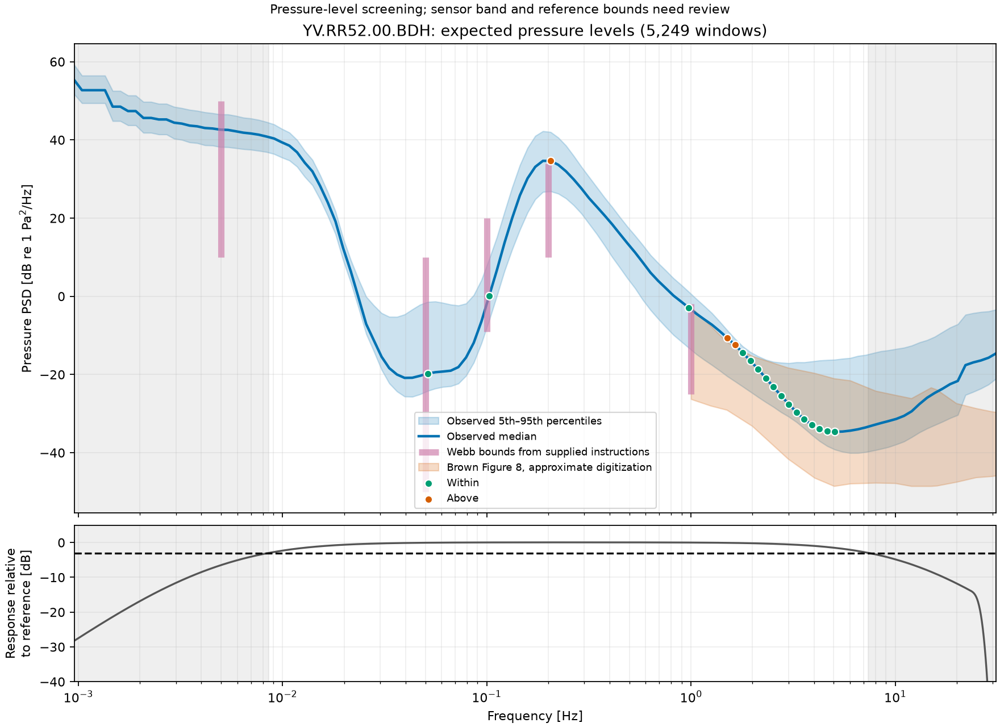
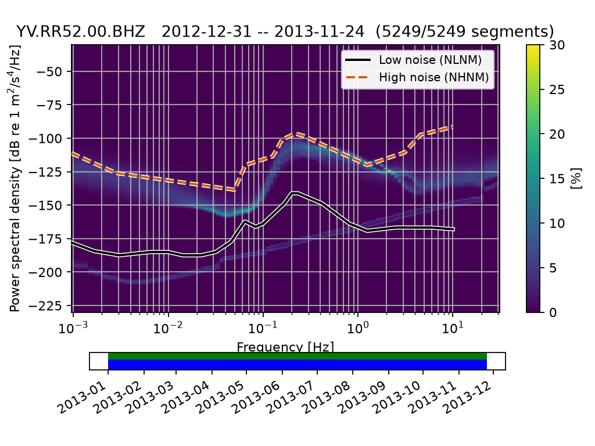
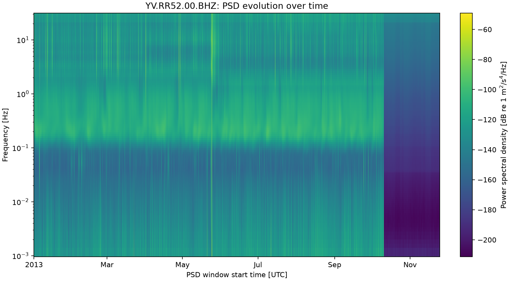
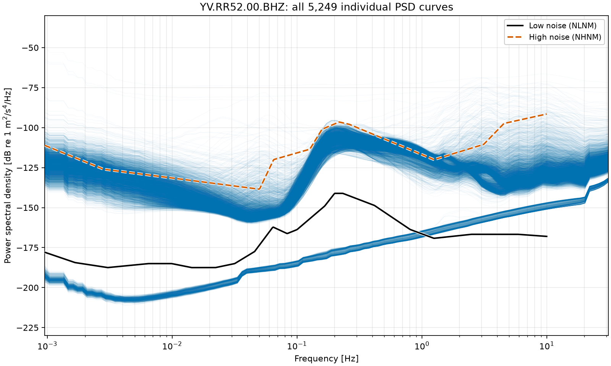
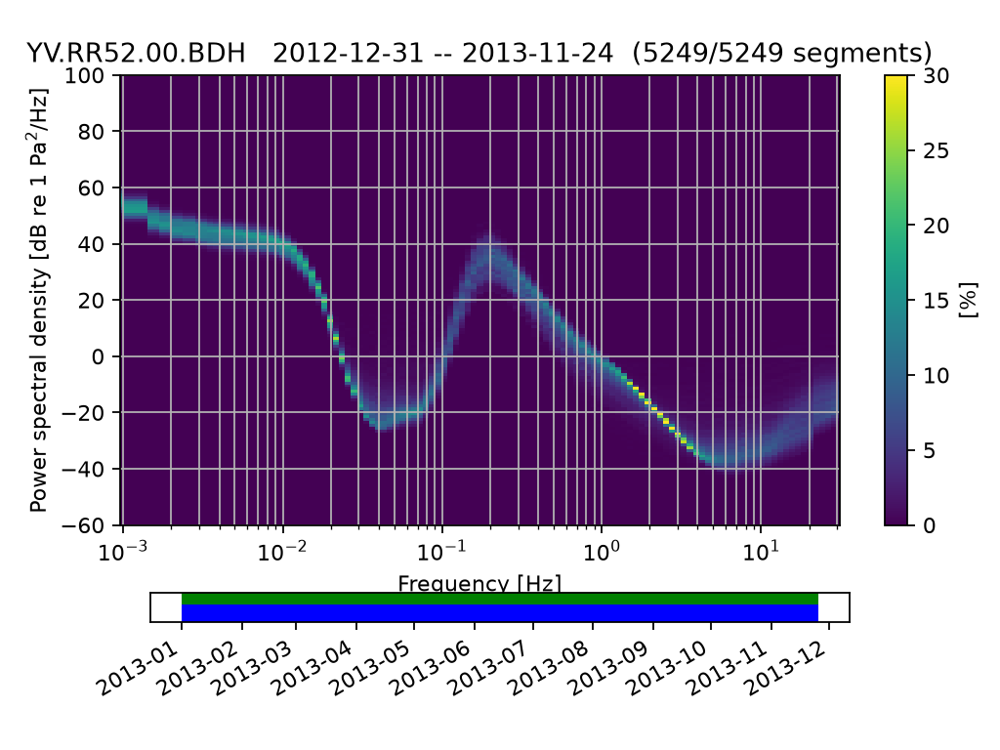

# RR52 diagnostic figures

These twelve figures were copied from the verified full RR52 calculation.
Each channel contains 5,249 saved PSD windows, each averaging 3 hours, with
50% overlap and nominal 90-minute start spacing. See the
[methods, captions and limitations](../../rr52_methods.md) and
[numerical run summary](../../rr52_run_summary.json).

| Channel | Probability distribution | Time evolution | All individual curves |
| --- | --- | --- | --- |
| BDH, pressure | [Distribution](BDH_ppsd.png) | [Spectrogram](BDH_spectrogram.png) | [5,249 curves](BDH_all_psd_lines.png) |
| BH1, horizontal 1 | [Distribution](BH1_ppsd.png) | [Spectrogram](BH1_spectrogram.png) | [5,249 curves](BH1_all_psd_lines.png) |
| BH2, horizontal 2 | [Distribution](BH2_ppsd.png) | [Spectrogram](BH2_spectrogram.png) | [5,249 curves](BH2_all_psd_lines.png) |
| BHZ, vertical | [Distribution](BHZ_ppsd.png) | [Spectrogram](BHZ_spectrogram.png) | [5,249 curves](BHZ_all_psd_lines.png) |

Distribution colors represent occurrence probability. Spectrogram colors
represent spectral amplitude in dB; columns are placed at UTC window starts.
The line views include every saved curve without subsampling or averaging.
Seismic spectra reference acceleration PSD (m²/s⁴/Hz); pressure spectra
reference Pa²/Hz. Seismic distributions and curve views include Peterson's
NLNM/NHNM, accessed through ObsPy; pressure views have no seismic model overlay.
These are diagnostic comparisons, not calibration pass/fail results.

## Expected pressure-level comparison

An additional [BDH comparison figure](BDH_pressure_comparison.png) shows the
observed 5th/50th/95th percentile pressure spectra, supplied Webb bounds and
approximately digitized Brown hydroacoustic curves. Its lower panel shows the
nominal instrument response band; shaded frequencies are excluded from testing.
See [comparison details](../../pressure_comparison.md) for the calculations,
reference provenance and pending review.

Two further views use magenta for Webb and orange for Brown:

- [PPSD with lower/upper limits](BDH_ppsd_with_limits.png): probability
  distribution with discrete Webb limits and Brown's PSD-bin-averaged limits.
- [Test details](BDH_test_details.png): median clearance from the bounds and
  percentage of PSD windows within range, with a separate column per reference.

There are now three pressure-comparison figures alongside the original twelve.

## Godin infragravity model comparison

Three additional pressure views show the depth-dependent prediction:

- [Observed percentiles and model](BDH_godin_model_comparison.png)
- [Pressure PPSD with model](BDH_godin_ppsd_with_model.png)
- [Observed-minus-model residuals](BDH_godin_model_residuals.png): diagnostic
  overview and eligible-bin detail, showing overlapping frequency widths and
  the empirical window spread rather than confidence intervals.

Godin's model is orange. These are diagnostic comparisons with no assigned
acceptance tolerance. See [model details](../../infragravity_comparison.md).

## Screened Godin pilot

A separate raw-data pilot uses a week near mid-recording and full 12.42-hour
Hann windows. It retains 20 of 21 windows after count-based transient screening.

- [Retained pressure mean and Godin model](BDH_godin_pilot_pressure_model.png)
- [Notch levels and screening decisions](BDH_godin_pilot_screening.png)
- [Same-interval comparison with the three-hour PPSD](BDH_godin_pilot_ppsd_comparison.png)

[Method and saved data](../../godin_pilot.md). Calibration scores remain blank.

## Vertical acceleration distribution

## Vertical acceleration over time

## Every vertical acceleration spectrum

## Pressure distribution

Reference: Peterson, J. R. (1993), *Observations and modeling of seismic
background noise*, USGS Open-File Report 93-322,
[doi:10.3133/ofr93322](https://doi.org/10.3133/ofr93322).

## Teleseismic Rayleigh pilot

The current Santa Cruz examples use actual TiSKitPy CleanRotator and provisional
RR52 pressure sign −1. Its overlapping predicted packet keeps this event in
amplitude review; no calibration factor is applied to saved data.

- [Wide arrival and overlap review](rayleigh_tiskitpy_arrival_review.png)
- [Amplitude, coherence and nominal/provisional phase](rayleigh_tiskitpy_comparison.png)
- [Selected pressure/acceleration waveforms](rayleigh_tiskitpy_waveform.png)

[Review instructions](../../rayleigh_window_review.md) ·
[Method and limitations](../../rayleigh_calibration_review.md).
Earlier `rayleigh_calibration_*` figures retain the initial local-method,
metadata-sign comparison.

The combined paper Figure 5 / thesis Figure 3.13 layout is now also saved:

- [Original-figure band, 0.03–0.07 Hz: three candidates](rayleigh_paper_figure5.png)
- [Preserved default band, 0.02–0.06 Hz: two candidates](rayleigh_paper_figure5_default_band.png)

Green: individual events; blue: medians; purple: theory; black dashed: candidate
gain-adjusted median ratio; red dashed: actual fit limits. These are provisional
comparisons. [Exact results and commands](../../rayleigh_paper_figure.md).
