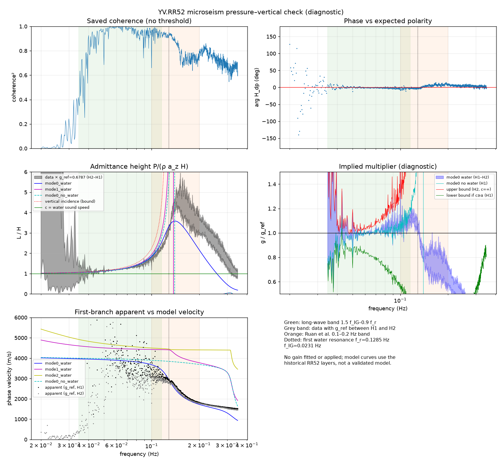

# Microseism pressure–vertical check (RR52 pilot)

Independent implementation of the task in
[microseism_next_chat.md](microseism_next_chat.md). This check reads saved
paired spectra only. It does **not** fit, apply or store a pressure gain, change
masters or scores, or write beside its inputs. Status: `diagnostic_only`.

## Theory

Consider a homogeneous acoustic water layer (depth H, density ρw, sound speed
α) with a free surface, carrying one plane wave with horizontal phase velocity
c. The gauge pressure at the moving seafloor and the upward acceleration then
satisfy

```text
P = ρw · L(f, c) · a_up
L = H · tan(y)/y   if c > α      y = 2π f H · sqrt(|1/α² − 1/c²|)
L = H · tanh(y)/y  if c < α
```

This is [Zha & Webb (2016)](https://doi.org/10.1002/2015JB012688) A5, the same
relation as `rayleigh_calibration.water_ratio`. The solid Earth enters only
through c. Upward displacement relates to pressure through `D/P = −1/(ω² ρw L)`.
A pressure multiplier g (true = g · s · nominal, with s the pressure sign) and an
uncertain vertical response g_z therefore give

```text
H_nominal = D/P_nominal = −(g/g_z) · s / (ω² ρw L(f, c))
```

Three consequences follow from the water layer alone:

1. **Long-wave limit.** L → H as fH/α → 0 for every c, so P ≈ ρw H a_up. This
   regime is why teleseismic Rayleigh calibration works.
2. **Below the first water-column resonance `f_r = α/(4H)`.** For every real
   slowness, 0 < L ≤ L(c = ∞) (vertical incidence). Pressure polarity is then
   fixed by the observed phase, and `g/g_z ≤ ω² ρw L(∞) |H_true|` without any
   structure model. Incoherent noise keeps `|H1| ≤ |H_true| ≤ |H2|`, so the
   bound is tested with both estimators (H1 = S_dp/S_pp, H2 = S_dd/S_pd).
   A lower bound needs a minimum c; assuming c ≥ α gives L ≥ H.
3. **Above f_r.** L spans (−∞, ∞) over admissible c, so the ratio cannot
   constrain g without knowing c, i.e. the sediment structure and mode mixture.
   [Ruan, Forsyth & Bell (2014)](https://doi.org/10.1002/2014JB011162) use this
   0.1–0.2 Hz sensitivity to **invert D/P for sediment shear velocity**. Their
   inversion also fits one constant DPG scale factor per station, which they
   state is "primarily constrained by the transfer function at frequencies below
   0.10 Hz where there is little sensitivity to the sediments". In other words,
   the gain comes from the long-wave part and the structure from 0.1–0.2 Hz.

The same relation is derived and validated for body waves and Rayleigh waves
by [Deng et al. (2022)](https://doi.org/10.1029/2021GL096952), eqs. 5–6
(`p = ρha · tan(x)/x`). They check it on real data up to just below c0/4h and
use it in both directions: gain from near-vertical body waves, where F is
insensitive to slowness, and single-station phase velocity near c0/4h, where
F is sensitive. That is the same split as the regimes above.

Gravity (first-order free-surface term, Lagrangian gauge pressure) is
implemented as a sensitivity only. Interior compressibility–gravity coupling, of
order gH/α² ≈ 1%, is not modelled.

### Identifiability

The microseism P/Z ratio does **not** identify an independent pressure
multiplier. It constrains g/g_z jointly with the horizontal slowness of the
coherent wavefield:

| Regime | What it gives |
| --- | --- |
| below f_r, structure-free | pressure polarity; one-sided upper bound on g/g_z |
| below f_r, assume c ≥ α | weak two-sided bracket |
| below f_r, dispersion model + mode | model-conditional value; same assumptions as the Rayleigh calibration, different data |
| above f_r (incl. most of 0.1–0.2 Hz at RR52) | no gain constraint; apparent phase velocity given a fixed g |

Turning this into a gain would need extra constraints that do not exist yet:

* an independent vertical-response check (g_z). [Ball et al. (2014)](https://doi.org/10.1002/2014GC005412)
  state this directly for the long-period P/A = ρH calibration: errors in the
  acceleration and DPG responses are corrected together, and the DPG gain alone
  follows only if the acceleration response is assumed correct;
* verified water depth and an in-situ density and sound-speed profile;
* for 0.1–0.2 Hz, an independent phase velocity or sediment model. Inferring
  sediments from the same D/P would be circular.

A structure-free per-band gain is possible from **near-vertical teleseismic
body waves**: with ray parameter q ≲ 10 s/deg, F barely depends on q (Deng et
al. 2022, Fig. 4f). This is the natural next check, alongside the planned
local-P work. It would also test whether the DPG response is frequency
dependent, as Deng et al. found at XO WD66 (Cp ≈ 0.91 at 0.02–0.03 Hz falling to
≈ 0.80 at 0.06–0.07 Hz).

## Implementation

`src/bruitfm/microseism_check.py`:

- validates the saved run's conventions, units and window-mean arithmetic, and
  the reference's station/epochs and optional SHA-256. It hashes every input
  before and after the run and refuses any change;
- applies the reference's g, sign, depth, density and sound speed unchanged;
- computes disba fundamental and overtone Rayleigh dispersion from the
  historical RR52 layers, both with a prepended water layer and without one
  (the reference lineage);
- reports, per bin and per band: coherence, phase against the expected
  polarity, admittance height, first-branch apparent phase velocity, the
  structure-free bound, the c ≥ α bound and model-conditional multipliers
  (H1 and H2);
- reports four fixed equal-log-width sub-bands with per-day values, plus
  illustrative depth ±2%, α 1480/1540 m/s, ρ 1035 kg/m³ and gravity
  sensitivities.

Bands are fixed by physics, not chosen from the data:

* long-wave band: 1.5 f_IG to 0.9 f_r, where f_IG = sqrt(g/(2πH)) is the
  infragravity cutoff (wave pressure decays by more than e⁻¹⁴ above 1.5 f_IG);
* the Ruan 0.1–0.2 Hz band;
* f_r to 2 f_r.

Tests (`tests/test_microseism_check.py`, 19 pass):

- the closed form matches direct numerical integration of the water-column ODE,
  with and without gravity, on both branches;
- it matches the existing `water_ratio`;
- the long-wave limit holds, and the bound holds for all c below f_r and fails
  above it;
- phase-velocity inversion round-trips and refuses inputs outside the branch;
- disba's water-layer fundamental mode matches an independent water-layer
  Scholte–Rayleigh secular equation for water over a half-space;
- the no-water model reproduces the bundled reference dispersion;
- a synthetic saved run recovers a known gain exactly, flags a reference above
  the bound, preserves its inputs and refuses convention drift, output beside
  inputs and hash mismatch.

```bash
R=results/NETWORKS/TEST/YV/RR52/YV.RR52.00.BDH__20121019T090000__58afc2d6f005
PYTHONPATH=src conda run --no-capture-output -n bruitfm python -m bruitfm.microseism_check \
  --paired-run $R/paired_spectra/run_bfbef17f2c13 \
  --reference-result $R/rayleigh_calibration/run_392920872d9c/comparison.json \
  --reference-sha256 0d6f7552d45fe1ad59194a6c45dd00501b3bf6ca6c54c8f8f0a324d93a5314e9
```

Equivalent one-line runner (uses this branch's `src`, reads the main checkout's
saved results, writes a new run folder in this checkout; add `--show` to open
the figure):

```bash
bash scripts/run_rr52_microseism_check.sh
```

It takes seconds; outputs go to a new `results/EXPERIMENTS/MICROSEISM/YV.RR52/run_*`.

## All YV stations

Results and phase screen: [yv_microseism_check.md](yv_microseism_check.md).

```bash
bash scripts/run_yv_microseism_check.sh
```

Add `--open-plots` to show the summary figure. Use `--resume RUN_DIR` to continue
an interrupted run, or `--station RRxx` (repeatable) to run selected stations.

The runner covers all 43 YV pressure epochs with completed PPSDs and takes about
15 minutes. For each station it does the following:

- **Paired spectra.** Computes them from raw waveforms with the existing
  `paired_spectra` code. On this branch, `run_paired_spectra(..., output_root=...)`
  writes into the run's own folder, never beside PPSDs, and refuses master
  updates.
- **Interval.** Uses the common week starting 2013-06-10. Only when coverage
  cannot hold that week does it fall back to the default 7 days centred on
  shared coverage. Intervals are never searched for coherence.
- **Check.** Runs the check with the master `Profondeur` depth, ρw = 1028 kg/m³,
  α = 1500 m/s and the historical layer model, with no reference gain.
- **Comparison.** Compares the result with recorded baseline, trial and published
  (Aminian 2025) gains from `docs/socrates_all_station_comparison.csv` and
  `docs/calibration_network_summary.json`. For each gain it reports the per-bin
  structure-free bound fractions.
- **Best-conditioned sub-band.** Of the four fixed long-wave sub-bands, picks the
  one with the smallest ratio of structure-free H2 bound to model-conditional
  H1 value. This ratio covers the full noise plus structure spread and does not
  use any reference gain. The conditioning ratio is reported. Stations far
  above 1 are uninformative, not failed.

Outputs are written to `results/EXPERIMENTS/MICROSEISM_YV/run_*/`:

- `settings.json`;
- `stations/<RRxx>.json`;
- `stations.csv` and `summary.json`;
- `yv_microseism_check.png`;
- `paired/` and `checks/` with per-station products.

The run checks that the master CSV/XLSX hashes are unchanged. Errors are isolated
per station, and pairing failures (for example RR12's flat pressure) are
recorded as `unresolved_pairing`.

A five-station trial shows coherence varies strongly between stations:

| Station | Coherence² in long-wave band | Usable sub-band | Conditioning ratio |
| --- | --- | --- | --- |
| RR52 | high | 0.047–0.063 Hz | 1.05 |
| RR17 | ≤ 0.02 below 0.109 Hz | 0.109–0.153 Hz only | 1.27 |
| RR41 | ≤ 0.19 | none informative | 8 |

So many stations may give no informative long-wave constraint. This is
expected ambient-noise behaviour, not evidence of a sensor fault. Ruan et al.
(2014, Fig. 3) show P–Z coherence in noise collapsing in the "low-noise band"
between the infragravity band and the 0.1–0.2 Hz microseism peak; there they
used earthquake Rayleigh waves instead. RR52's high long-wave coherence in
June 2013 needs strong primary-microseism energy, as in southern-hemisphere
winter.

## RR52 result (2013-06-10 to 06-17, 167 hourly pairs)

The inputs are those in the handoff. `spectra.npz` in `run_bfbef17f2c13` is
byte-identical to that in the validated `run_68eef075f78e` (SHA-256 `5ffc9082…`).
The fixed reference is g = 0.6787278140712512, sign −1 (still
`assumed_needs_confirmation`), H = 2918 m (inventory elevation), ρw = 1028 kg/m³,
α = 1500 m/s. That gives f_r = 0.1285 Hz, f_IG = 0.0231 Hz and a long-wave band
of 0.0347–0.1157 Hz.

**Polarity.** In the long-wave band (292 bins), the median phase is −1.0° and
every bin lies within 90° of the 0° expected for sign −1. Sign +1 would require
180° there, for any structure. This supports the assumed −1 sign independently
of earthquakes and models, conditional on the vertical polarity and the
single-water-layer physics. In 0.1–0.2 Hz the median phase is +4.1° (5th–95th
percentile −4.2° to +11.3°).

**Structure-free bound** (long-wave band):

* median upper bound on g: 0.732 (H1) to 0.785 (H2);
* g_ref sits below the bound in 80.5% of bins, is inconclusive (between the H1
  and H2 bounds) in 18.5%, and exceeds the H2 bound in 3 bins (1.0%).

The 3 exceeding bins, at 0.0475–0.0494 Hz, are each only 1–2% above. The bound
scales with ρw·H, so ±2% depth alone moves it ±3%. This is no evidence against
g_ref.

**Model-conditional multiplier** (fundamental mode with water layer;
diagnostic only, not a gain):

| Sub-band (Hz) | coh² | g (H1–H2) | vs g_ref |
| --- | --- | --- | --- |
| 0.0347–0.0469 | 0.811 | 0.619–0.749 | −8.8…+10.3% |
| 0.0469–0.0633 | 0.986 | 0.671–0.681 | −1.2…+0.4% |
| 0.0633–0.0856 | 0.976 | 0.683–0.703 | +0.6…+3.5% |
| 0.0856–0.1157 | 0.947 | 0.704–0.751 | +3.7…+10.7% |

* Across the whole band the range is 0.681 (H1, +0.3%) to 0.719 (H2, +5.9%).
* The no-water reference dispersion gives 0.684–0.725.
* Overtone dispersions give +2.1…+9.3%.
* The upward drift toward f_r is where L becomes sensitive to c: near 0.1 Hz the
  apparent phase velocity (median 3.29 km/s with H1, 2.96 km/s with H2, over
  0.09–0.116 Hz) is slower than the model fundamental mode (3.42–3.76 km/s).
  The historical model is one likely limit. A frequency-dependent DPG response
  (Deng et al. 2022) is an alternative that this check cannot separate.
* The best-conditioned sub-band (0.047–0.063 Hz) agrees with the earthquake
  reference to within about 1% in its H1–H2 bracket.
* The per-day values there are 0.674/0.679, 0.668/0.676 and 0.650/0.679 (H1/H2)
  on the three high-coherence days (13, 15 and 16 June). On low-coherence days,
  H1 and H2 diverge strongly, so single days are not reliable.

**Sensitivity** (long-wave band, H1, mode 0 with water):

| Change | vs g_ref |
| --- | --- |
| depth −2% / +2% | −3.3% / +3.7% |
| α 1480 / 1540 m/s | +1.4% / −2.2% |
| ρw 1035 kg/m³ | +1.0% |
| free-surface gravity | −1.0% |

The gravity term is also absent from the reference theory (`water_ratio`), so it
cancels in this comparison. It is a lead for scientific review, not a correction.

**0.1–0.2 Hz (Ruan band).**

* Median coh² is 0.802.
* With g_ref fixed, the admittance height is 3.2–4.2 H and the first-branch
  apparent phase velocity is 2.32–2.42 km/s. The water-layer model's fundamental
  mode is 2.24 km/s and its overtones are 4.07 km/s or faster.
* Overtone or no-water dispersions predict the wrong sign in 60–63% of these
  bins.
* Pure fundamental-mode theory would need g = 0.46–0.60, which is inconsistent
  with the long-wave band. A modest model or mode-mixture change is enough to
  close the gap.
* This band therefore reflects sediments and mode content (Ruan 2014), and
  **cannot calibrate RR52's DPG**.

**Tilt and noise.** Ruan et al. (2014) tilt-corrected the vertical (Bell et al.
2015 method) and kept only coherence > 0.95. This check does neither: it uses
the saved uncorrected pilot and no coherence threshold. Aminian et al. (2025,
Fig. 4) report RR52 tilt of about 2.3°, stable after a 2 May 2013 jump, so the
June pilot week falls in the settled period. The saved pair has no horizontals.
Noise uncorrelated with pressure biases H2 upward, not H1, under a single scalar
transfer model. The approximately 1.5% H1–H2 gap in 0.047–0.063 Hz describes
that noise model only. Tilt correlated with pressure or mode mixing can bias
both estimators; this gap cannot establish that tilt correction is unnecessary.
Below about 0.045 Hz, coherence falls and the bracket widens,
whether from tilt, compliance leakage or low signal; that part should not be
interpreted without horizontals. Infragravity compliance is negligible above
1.5 f_IG. The nominal pressure response varies by 2.5% in amplitude across the
long-wave band; a frequency-dependent response error is not tested.

## Primary-source verification

These were read in full (user-supplied PDFs, 14 October 2026):

* **Ruan et al. (2014).** Eq. 2 is our H1 (`⟨u P*⟩/⟨P P*⟩`). The fundamental
  mode is zero-phase; higher modes can flip sign by π. Coherence falls above
  0.2 Hz from higher modes. Table 1 uses ρw = 1.030 g/cm³ and α = 1.5 km/s;
  they found no noticeable sound-speed-profile effect below 0.2 Hz on log
  admittance, which is consistent with the 1–2% sensitivity here. In the long
  period limit, P/a → ρH.
* **Deng et al. (2022).** Eqs. 5–6 match `admittance_height` exactly (same F
  values to 3 decimals at RR52). Cp multiplies the recorded pressure ("p × Cp"),
  the same direction as this project's g. That resolves the earlier open
  question about the direction of their XO coefficients; their band values are
  not yet compared with the project's XO gains.
* **Ball et al. (2014).** P/A = ρH at periods well below the water resonance
  (about 30 s); MOANA mean 0.9 ± 0.1 ρH. The calibration is of the combined
  pressure/acceleration response.
* **Aminian et al. (2025).** The RR52 gain of 0.67 ± 0.034 comes from Mw > 7
  teleseismic Rayleigh P/a ratios, normalised by ρh and fitted by grid search
  following Zha & Webb (2016) and Ruan et al. (2014). The DPGs (Cox et al. 1984)
  record efficiently over 0.002–30 Hz, which covers the band used here. This
  code reproduces the Fig. 5b theory at RR52: L/H = 1.04, 1.12, 1.28, 1.87 at
  0.03, 0.05, 0.07, 0.10 Hz.

Zha & Webb (2016) was not available within this original Claude pilot review.
The project's earlier [full-text audit](reviews/socrates_initial_audit.md)
separately verified Appendix A and the coefficient direction. Its numeric Lau
velocity model and nominal-sensitivity conventions still need reconciliation.

## Limitations

- These results constrain g/g_z. The vertical response is assumed correct, as in
  the reference.
- Depth comes from inventory elevation (no bathymetry). Density and sound speed
  are homogeneous assumptions.
- The dispersion model is the historical RR52 layer model, which is not
  validated. The model-conditional values share the reference's model
  assumptions, so they test data and window consistency, not model accuracy.
- One week of correlated hourly windows; there are no confidence intervals. The
  H1–H2 range is a noise bracket, not an uncertainty.
- Pressure polarity is still a single-layer, plane-wave inference. Hardware
  polarity documentation remains the authority. Ruan et al. (2014) expect zero
  phase for the fundamental mode and note that a significant nonzero phase can
  indicate instrument-response problems. The published calibrations reviewed
  here (Ruan, Ball, Aminian) use amplitude ratios and do not test sign.
- Deeper stations have lower f_r: at 5 km depth f_r is 0.075 Hz, so the
  long-wave band narrows to the primary microseism.

[Summary JSON](rr52_microseism_check.json) ·
[Figure](figures/rr52/microseism_check.png)


